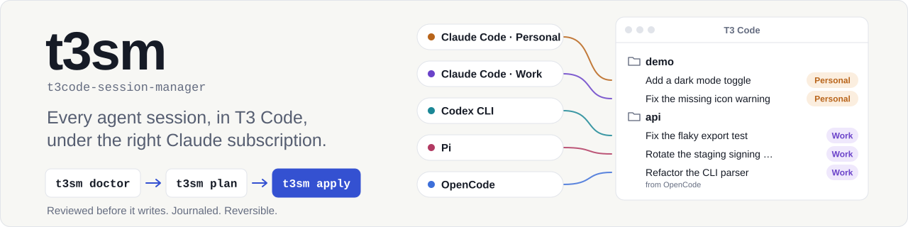
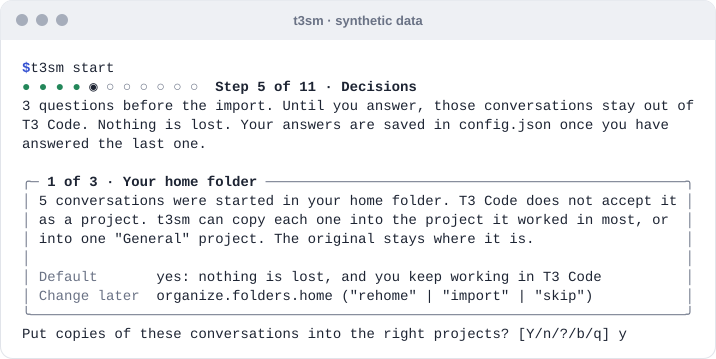
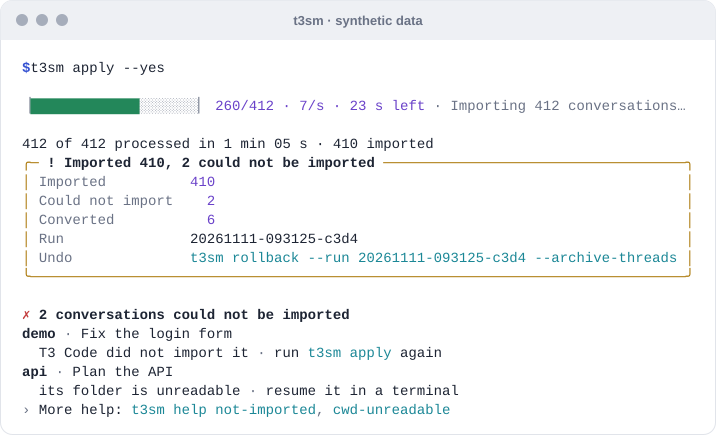
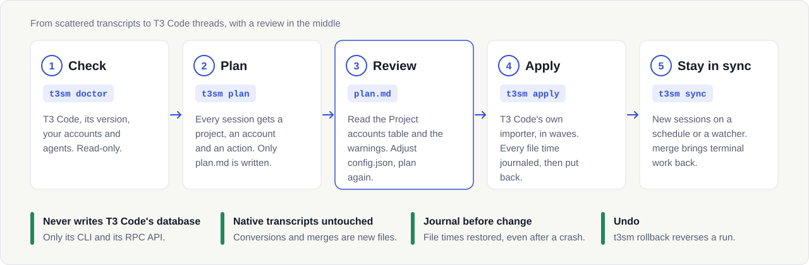
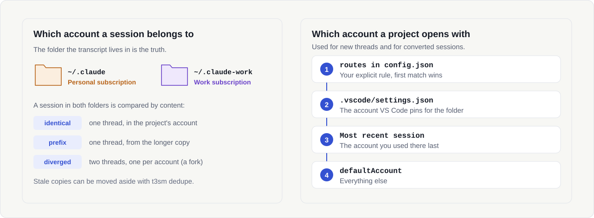
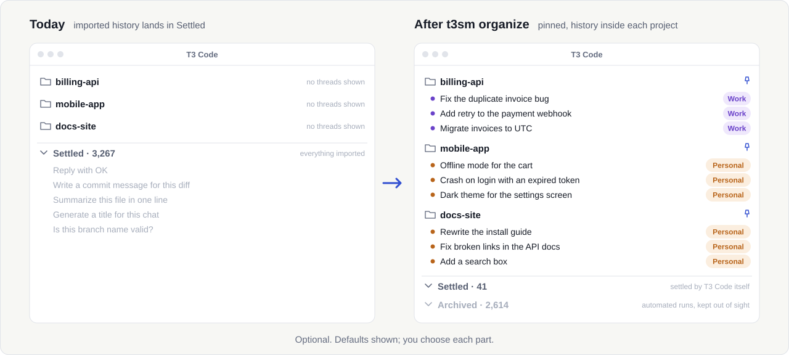
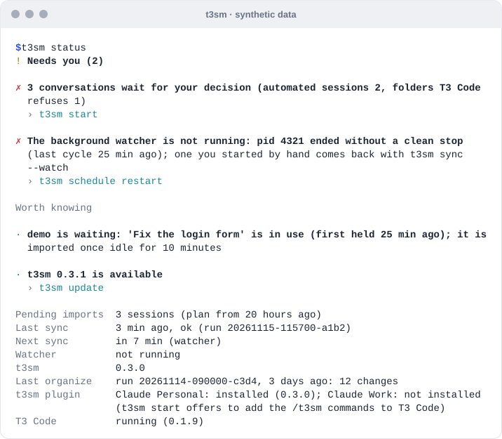

<picture>
  <source media="(max-width: 600px) and (prefers-color-scheme: dark)" srcset="docs/assets/hero-narrow-dark.svg">
  <source media="(max-width: 600px)" srcset="docs/assets/hero-narrow-light.svg">
  <source media="(prefers-color-scheme: dark)" srcset="docs/assets/hero-dark.svg">
  
</picture>

<p align="center">
  <a href="https://github.com/brunobola-portfolio/t3code-session-manager/actions/workflows/ci.yml"></a>
  <a href="LICENSE"></a>
  
  
  <a href="https://www.npmjs.com/package/t3code-session-manager"></a>
  
  ·&nbsp;<a href="README.pt.md">Português</a>
</p>

**t3sm** puts every session from every coding agent and every Claude account into
[T3 Code](https://t3.codes), as threads you can resume, each under the subscription it
was run with. T3 Code is an open-source (MIT) desktop app for coding agents such as
Claude Code and Codex: you need it installed and running.

Your history is scattered across VS Code windows, Claude accounts and agents, and T3
Code's own import takes only the last 30 days, 100 sessions at a time, without knowing
which subscription each project belongs to. t3sm brings all of it in, reviewed first.

## Quick start

You need Node.js 22.18+ and T3 Code open. Open it from the Start menu or your
desktop launcher, not from a terminal that sets `CLAUDE_CONFIG_DIR`.

**1. Install once.** The same line on Windows, macOS and Linux:

```bash
npm install -g t3code-session-manager
```

Every npm release is built by GitHub Actions from its tag and signed with
[provenance](https://docs.npmjs.com/generating-provenance-statements) (`npm audit signatures`
checks it). From GitHub instead: `npm install -g --install-links github:brunobola-portfolio/t3code-session-manager#v0.5.0` (needs git).

**2. Run it:**

```bash
t3sm
```

The guided set-up takes it from there: check, plan, the questions only you can answer, a
pilot project, the full import, tidying the history and background sync. It explains each
step and asks before every write. Stop at any question, then run `t3sm` again to continue.
t3sm speaks English, and European Portuguese on a Portuguese system (`--lang en|pt` chooses).

<picture>
  <source media="(max-width: 600px) and (prefers-color-scheme: dark)" srcset="docs/assets/screen-start-narrow-dark.svg">
  <source media="(max-width: 600px)" srcset="docs/assets/screen-start-narrow-light.svg">
  <source media="(prefers-color-scheme: dark)" srcset="docs/assets/screen-start-dark.svg">
  
</picture>

**3. Updates come by themselves.** Once the background sync is installed, t3sm installs
newer patch and minor releases once a day and restarts itself
([Automatic updates](#automatic-updates)); `t3sm update` does it by hand. Your settings and
run history carry over.

<details>
<summary><b>Prefer to run each step yourself?</b></summary>

```bash
t3sm doctor                        # check: warnings (!) are fine; a failure (✗) says how to fix it
t3sm plan                          # writes plan.md and prints its path: read it
t3sm apply --dry-run               # what apply would do (writes nothing)
t3sm apply --only "C:/work/demo"   # pilot one project
t3sm apply                         # everything
```

If the plan lists **mirror copies** or doctor reports **backup folders**, run `t3sm dedupe`
or `t3sm quarantine` before `apply`, each with `--dry-run` first (reversible; see
[Choosing your subscription](#choosing-your-subscription)). `apply` shows the summary
and waits for `yes`. In `plan.md`, check the **Project accounts** table: it says which
subscription each project will use. With thousands of sessions, `t3sm plan --html` also
writes `plan.html` next to it: one local file to open in a browser, with filters by project,
account, action and skip reason and a search box (it loads nothing from the network). Step by step, with every check:
[docs/switching-from-vscode.md](docs/switching-from-vscode.md).

</details>

No install at all? `npx -y t3code-session-manager <command>` runs any command (background
sync needs the installed one). To be strict about what you run, pin the version
(`t3code-session-manager@<version>`). Other sources:
[docs/migrate/](docs/migrate/claude-code.md). In Claude Code you can also ask for it in
plain words with the bundled skill ([docs/install.md](docs/install.md#claude-code-plugin)).

### First run checklist

- **Keep the machine awake** until `apply` finishes. If it sleeps during an import, t3sm
  stops that batch when it wakes, puts its file times back, and leaves the rest for the
  next run.
- **Close the sessions** of the projects you want imported. A project with a session
  written in the last 10 minutes waits for a later run.
- **Pause cloud sync of your home folder** (OneDrive, Dropbox, iCloud) during the first
  `apply`. A sync client can lock transcripts (t3sm then holds those projects for the
  run) or copy files while their times are moved.
- **Install the schedule only after the first full `apply`**: `sync` imports nothing
  while more than 200 sessions are pending.
- **Always name the run you undo:** `t3sm rollback --run <id>` (`t3sm runs` lists them).
  With `--yes`, `--run` is required, so a scheduled `sync` is never undone by mistake.
- If a run is interrupted (crash, power cut), the next t3sm command puts every moved
  file time back first. `t3sm doctor --repair` does only that.

<p align="center">
<picture>
  <source media="(prefers-reduced-motion: reduce) and (prefers-color-scheme: dark)" srcset="docs/assets/demo-static-dark.svg">
  <source media="(prefers-reduced-motion: reduce)" srcset="docs/assets/demo-static-light.svg">
  <source media="(prefers-color-scheme: dark)" srcset="docs/assets/demo-dark.svg">
  
</picture>
<br><sub>Synthetic demo: the <code>plan</code> summary, then <code>apply</code> importing in four waves.</sub>
</p>

## Check that it worked

<picture>
  <source media="(max-width: 600px) and (prefers-color-scheme: dark)" srcset="docs/assets/screen-import-narrow-dark.svg">
  <source media="(max-width: 600px)" srcset="docs/assets/screen-import-narrow-light.svg">
  <source media="(prefers-color-scheme: dark)" srcset="docs/assets/screen-import-dark.svg">
  
</picture>

- `apply` imports behind one progress bar and ends with a result panel: what was imported,
  what waits, the run id and the command that undoes it, and exit code 0. That run id is what
  `t3sm runs` lists and `t3sm rollback` takes. Conversations that could not be imported are
  listed by project and title with the reason in words (exit 5); `t3sm help <topic>` explains
  each reason.
- In T3 Code, each project of the plan is in the sidebar with its old sessions as
  threads. Opening a thread shows its history. Sending a message continues the original
  session, as a real turn on that thread's account (it uses your subscription).
- New threads in a project open with the account from the **Project accounts** table.
- `t3sm plan` again shows those sessions under `already-in-t3`, and `t3sm doctor` has no
  failure (✗). `t3sm runs` lists what was done:

```text
Run                   Started                   Command                            Status  Changes
20261111-094501-7f3a  2026-11-11T09:45:01.000Z  quarantine                         ok      quarantined 2
20261111-100003-b2d4  2026-11-11T10:00:03.000Z  apply 20261111-093012-a1b2 --only  ok      imported 18, defaults 1, instances 1, projects 1
20261111-101544-c3d4  2026-11-11T10:15:44.000Z  apply 20261111-093012-a1b2         ok      imported 394, files 6, defaults 11, projects 11
```

<sub>Real output of `t3sm runs` on a synthetic journal.</sub>

## The problem it solves

You work in several VS Code windows, each with the Claude Code extension, and you have
two Claude subscriptions, say a personal one in `~/.claude` and a work one in
`~/.claude-work`. Your history is split by account, by window and by agent, and the
same session can exist twice, once per account. T3 Code can import sessions, but only
the last 30 days, at most 100 per click, from the accounts it already knows, and
nothing tells it which subscription a project belongs to.

t3sm finds every session on the machine, decides which account owns each one, creates
what T3 Code is missing, and has T3 Code import everything, whatever its age, in
reviewed batches. Afterwards it keeps T3 Code in step with work you do in a terminal, and can tidy how the
imported history looks there.

## How it works

<picture>
  <source media="(max-width: 600px) and (prefers-color-scheme: dark)" srcset="docs/assets/flow-narrow-dark.svg">
  <source media="(max-width: 600px)" srcset="docs/assets/flow-narrow-light.svg">
  <source media="(prefers-color-scheme: dark)" srcset="docs/assets/flow-dark.svg">
  
</picture>

- **T3 Code imports, t3sm paces it.** Claude Code, Codex and Pi sessions are imported
  by T3 Code's own importer, so they resume natively. t3sm talks to T3 Code only
  through its `t3` CLI and its RPC API, never its database.
- **Old sessions without copies.** T3 Code imports only files touched in the last 30
  days. t3sm moves a batch's file times to "now" for a moment, imports, and puts them
  back. Every move is written to a journal first, and the next run repairs anything an
  interruption left behind.
- **One project at a time is safe.** T3 Code imports every recent transcript of a
  project at once, so t3sm parks the ones that should not go in (stale copies, excluded
  files, later batches) by setting their time 7 days **ahead**: Claude Code deletes
  old sessions by file time, so a parked file must never look old. A project with a
  session in use waits for the next run, and a batch interrupted by sleep stops and is
  retried.
- **Other agents are converted.** OpenCode sessions are written as Claude Code
  transcripts in the project's account, then imported like any Claude session. They
  resume in T3 Code and in `claude --resume`.
- **Everything is reviewable and reversible.** `plan` writes a report (and, on its
  first run, `config.json`) in t3sm's own folder and nothing else. `apply` asks first.
  `t3sm rollback` undoes a run. Details: [docs/architecture.md](docs/architecture.md).

## Choosing your subscription

<picture>
  <source media="(max-width: 600px) and (prefers-color-scheme: dark)" srcset="docs/assets/accounts-narrow-dark.svg">
  <source media="(max-width: 600px)" srcset="docs/assets/accounts-narrow-light.svg">
  <source media="(prefers-color-scheme: dark)" srcset="docs/assets/accounts-dark.svg">
  
</picture>

In T3 Code, an **instance** is one configured provider entry, such as "Claude" pointing at
one account folder. t3sm gives each Claude account its own instance, with its own name and
colour in T3 Code's model picker, so you choose the subscription per thread there, and
each project gets a default so new threads start on the right one. `apply` creates the
missing instances after you confirm the plan.

- **Discovered automatically.** From `~/.claude` and `~/.claude-*` folders,
  `CLAUDE_CONFIG_DIR` in shell aliases and functions (PowerShell, bash, zsh, fish), VS
  Code pins in `.vscode/settings.json`, the current shell and existing T3 Code instances.
  `t3sm accounts` shows what was found (emails masked; `--show-emails` for the full
  address). Optional: `t3sm accounts --init` writes the list to `config.json` so you can
  edit it, `--apply` creates the instances before any import (it asks first), and
  `--rename <id> "<name>" --color "#RRGGBB"` sets an instance's label in the picker.
- **A session keeps its account.** The folder a transcript lives in decides its account.
  A session copied into both accounts is compared: identical or shorter copies are
  mirrors (one thread), diverged ones are kept as two threads.
- **A project's default** comes from a `routes` rule, then the VS Code pin, then the
  account of the most recent session there, then `defaultAccount`.
- **The default instance is pinned.** If T3 Code's own Claude instance has no folder set in
  its settings, `apply` sets it to `~/.claude` (shown in the confirmation and in
  `apply --dry-run`), so a T3 Code started from a shell with `CLAUDE_CONFIG_DIR` cannot move
  it; until then `doctor` warns `instance-unpinned`. A session T3 Code already holds under
  another account is never imported a second time (`plan.md` lists it).
- **You can override it.** One line in `~/.t3code-session-manager/config.json`:

  ```json
  "routes": [{ "match": "C:/work/clients/**", "account": "claude-work" }]
  ```

Mirror copies matter because T3 Code's own Welcome import could pick a stale copy up under
the wrong account. `t3sm dedupe` moves them, and `t3sm quarantine` moves `.bak` folders
inside `projects/`, to a reversible quarantine. Sessions whose project folder no longer
exists are skipped as `cwd-missing`; if the project moved, a `remap` rule can point them
at the new folder (read its caveat first). More in [docs/accounts.md](docs/accounts.md)
and [docs/configuration.md](docs/configuration.md).

## Keeping in sync

```bash
t3sm sync                      # one cycle: import what is new since the last run
t3sm sync --watch              # stay resident and run a cycle when transcripts change
t3sm schedule install          # run sync every 15 minutes (Task Scheduler, launchd or cron)
t3sm schedule install --watch  # or start the watcher at logon
t3sm schedule status           # what is installed, last cycle
```

`sync` is built to run unattended, so it is cautious: it never creates instances or moves
files, waits for projects with a session in use, and imports nothing when more than
[`sync.maxUnattendedImports`](docs/configuration.md#sync) (200) sessions are pending, so the
first big import is always a reviewed `apply`. It never asks a question: sessions of a kind
you have not decided about yet wait, and `t3sm status` says so. What it does by itself, each
change journaled in the cycle's run (`t3sm rollback --run <id>` undoes it):

- organizes the conversations it has just imported (archives automated ones, gives readable
  titles);
- applies the [history rule](#the-history-rule) right after an import and once a day, at
  most 200 changes per cycle, never moving a conversation you changed by hand;
- brings in what you add to the original of a
  [copied conversation](#conversations-from-folders-t3-code-refuses) outside T3 Code;
- as a watcher, restarts itself into a newer t3sm after its next cycle, and looks for
  [updates](#automatic-updates) once a day.

**The background watcher.** `t3sm schedule install --watch` starts it at logon, and on
Windows and Linux checks every 15 minutes that it still runs (one already running is left
alone; on macOS launchd keeps it alive). `t3sm schedule restart` stops it and starts it
again; `install` and `remove` stop it first too. t3sm stops a watcher by asking it over its
own authenticated endpoint and, only if that fails, by its process id after checking that
this process is a t3sm watcher started when its heartbeat says. Never by name.

**Work continued in a terminal.** If you resume an imported session with
`claude --resume`, T3 Code does not see the new turns: it continues from the last message
it knows. `sync` and `doctor` report those sessions, and `t3sm merge` lists them.
`t3sm merge --all` writes a new session file next to the original with the complete
branch, imports it as a new thread and archives the old thread. The original file is never
edited, and `t3sm rollback` undoes it. Compacted sessions are not merged, and terminal work
on a side branch (not the one `claude --resume` continues) is listed with a hint, never
merged.

## Automatic updates

Once a day the background watcher looks up the newest release of the source t3sm was
installed from: GitHub's `vX.Y.Z` tags, or the `vX.Y.Z` tags on `main` of a checkout on this
computer (`t3sm update --from <folder>`). A newer **patch or minor** release (0.x minors
included) is installed by itself, in a separate hidden process, and the watcher restarts
into it. A **major** release is only announced (`t3sm status`, a notification): `t3sm update`
installs it after you say yes.

- **Health check and rollback.** After an install the new watcher must write a healthy
  heartbeat within 2 minutes. If it does not, t3sm reinstalls the previous version and
  restarts it: t3sm recovered by itself, so `t3sm status` mentions it as worth knowing, not as
  a need. The automatic check skips that version from then on; `t3sm update` can still install
  it on purpose.
- **Never a downgrade.** Only a release strictly newer than the installed one is installed.
- **Journaled.** Every update is a journal entry (from, to, outcome). `t3sm status` shows a
  recent update ("Updated to 0.3.1 yesterday") and `t3sm changelog` what is new.
- **Off switch.** `t3sm update --auto off` (and `on`). A git checkout or `npx` is never
  updated by itself.

**The one network call.** Apart from T3 Code on your own machine (loopback only), t3sm
itself contacts one thing: the release lookup (`npm view` on the npm registry, or
`git ls-remote` on GitHub for an install from GitHub), once a day from the watcher and when you run `t3sm update` or
`t3sm update --check`. Installing a release runs npm (and git), which download it. The only
other time anything goes online is the optional `/t3sm` plugin install in `t3sm start`,
after your yes (`claude plugin` commands). Nothing about your sessions is ever sent.

```bash
t3sm update --check            # installed, newest, patch/minor/major, source, automatic updates on or off
t3sm update                    # what is new, then it asks
t3sm changelog                 # the notes of the installed version
```

## Organize your history

<picture>
  <source media="(max-width: 600px) and (prefers-color-scheme: dark)" srcset="docs/assets/organize-narrow-dark.svg">
  <source media="(max-width: 600px)" srcset="docs/assets/organize-narrow-light.svg">
  <source media="(prefers-color-scheme: dark)" srcset="docs/assets/organize-dark.svg">
  
</picture>

An import is not the end of the story. T3 Code shows only unsettled threads inside a project,
and imported conversations arrive settled, so they sit in one long **Settled** list and your
projects look empty. In one real history about 80% of the sessions were runs by scripts
(Agent SDK), not conversations. And T3 Code cannot import conversations that were started in
your home folder or in a few other folders (Downloads, `Documents/Codex`, the temp folder). Temp and system folders are skipped by default, not copied.

`t3sm organize` tidies that, after showing you what it would do. t3sm is a small tool: it
uses only the commands T3 Code offers for this, and every part is optional.

| Part | What it does | Default |
| :-- | :-- | :-: |
| Automated sessions | Archives the ones started by scripts (Agent SDK), and those of a project t3sm created in a temp or system folder | on |
| Titles | Replaces a title that is a technical first message (`<command-name>`, `<ide_…>`) with a readable one, at most 80 characters | on |
| Titles written by T3 Code | With `--ai-titles`: T3 Code writes, with its own text model, the titles that stay technical (no usable first message). It spends your provider's tokens; the summary says how many, the model and the cap first (`--ai-titles-max`, 50 per run). Never in `t3sm sync` | off |
| History in projects | The [history rule](#the-history-rule): the last 90 days shown inside each project, at least 10 per project, the rest settled. T3 Code's own auto-settle setting is **not** changed unless you ask | 90 days, at least 10 |
| Pin | Pins the 5 projects with the most recent activity, and unpins the ones t3sm pinned that are no longer among them | on |
| Empty projects | Deletes empty projects that t3sm created | on |

```bash
t3sm organize --dry-run        # what it would change; writes nothing
t3sm organize                  # the same list, then it asks
t3sm organize --undo           # put back what it changed (asks first)
```

Each kind of change comes with how many, why and how to undo it. On a terminal, `d` at the
question opens the changes as a list you can uncheck one by one. Options:
`--only "<folder>"` (one project; no pins, no deletes), `--plain` (plain text, no
interactive screen), `--no-pin <ids>`, `--no-delete`, `--no-archive-folders` (leave the
conversations of projects t3sm created in temporary or system folders unarchived), `--history <days|all|off>` and
`--min <n>` (the history rule for this run only), and `--auto-settle <1..90|off>` if you also want T3 Code's own
option for the conversations you start there set to that many days, or off (recorded, and undone by `--undo`).
`--ai-titles` (with `--ai-titles-max <n>`) asks T3 Code for the titles that stay technical; `t3sm help ai-titles`
explains it. The defaults and the `config.json` keys are in
[docs/configuration.md](docs/configuration.md#organize). The guided set-up (`t3sm start`)
asks the same questions, one at a time, with your real numbers.

### The history rule

T3 Code shows only unsettled conversations inside a project; settled ones stay attached to
their project on the **Settled** shelf at the bottom of the sidebar. The rule, per project:

- every conversation active in the last **90 days** is shown;
- if that leaves fewer than **10** shown, the most recent settled ones are shown until 10 are
  (everything shown counts, conversations you started in T3 Code and pinned ones included);
- everything else is settled, oldest first, so the shelf keeps the order of your history.

Only imported conversations are ever moved (`import:` threads, whether t3sm or T3 Code's own import brought them in;
the ones you start in T3 Code are only moved by T3 Code's own option), and one you settled, showed, pinned or
archived by hand is never touched again. The activity date is T3 Code's own: the newest user
message or run, else when the conversation was created. `organize.history` in `config.json`
holds the numbers (`{ "days": 1-3650 or "all", "minPerProject": 0-1000 }`),
`t3sm organize --history <days|all|off> --min <n>` uses others for one run, and `t3sm sync`
applies the rule once a day. For the conversations you start in T3 Code, T3 Code has its own
option (settle after 1 to 90 days without use): the guided set-up offers to set it to the same
days, and `t3sm organize --auto-settle <1..90|off>` sets it (journaled, undone by `--undo`).
`t3sm help history` explains it in your language.

**What it never touches:** conversations you started in T3 Code, projects you created
(except to pin them, and to unpin what t3sm pinned), T3 Code's settings (except `--auto-settle`, if you ask), and
anything you changed by hand afterwards: a conversation you unarchived, renamed or reopened,
a project you unpinned. That choice is yours for good. `t3sm rollback --run <id>` undoes an
organize run too, exactly like `--undo`. Because undoing changes T3 Code, `--undo --yes`
needs the run id (`t3sm organize --undo <run> --yes`), like `rollback`.

### Conversations from folders T3 Code refuses

By default t3sm copies them, whole and unchanged, into the project they worked on. It reads
the paths the conversation touched: "63 of 80 paths are in `~/code/billing-api`" is enough
(at least 60% of the paths and at least 5 hits). With no clear project they go to a project
called **General** (`~/T3 General`; `~/T3 Geral` in the Portuguese assistant), whose folder
`t3sm apply` creates when it is missing (never `sync`; `rollback` removes it again while it is
empty). A folder T3 Code refuses, or a temporary or system one, is never used. The original is
never modified, and `rollback` removes the copy. If you keep talking in the original
**outside T3 Code after the import** (VS Code, from the home folder), `t3sm sync` follows it:
once the original and the copy have been idle for 10 minutes, it writes a new copy with the
new messages, imports it as a new thread with the old thread's title and settled state, and
only then archives the old thread. A copy you also continued in T3 Code is never
overwritten: `t3sm status` names both, and you choose. Temp and system folders, and automated
sessions, are skipped by default. Folder
rules can be changed per folder (`organize.overrides`), but an override never imports an
automated (Agent SDK) session: `organize.sessions.automated` decides those.

**Conversations started in T3 Code** are recognised and never imported again. If you deleted
such a conversation's thread in T3 Code, T3 Code refuses to import it again: after one
question (default yes) t3sm brings it back as a faithful copy with a new session id
(`organize.sessions.orphaned`). One whose thread t3sm cannot identify is left out, never
copied, so a live conversation is never duplicated.

### Know what needs you

```bash
t3sm status                    # "All good", "Needs you (N)" with the command for each, or "Working"
```

<picture>
  <source media="(max-width: 600px) and (prefers-color-scheme: dark)" srcset="docs/assets/screen-status-narrow-dark.svg">
  <source media="(max-width: 600px)" srcset="docs/assets/screen-status-narrow-light.svg">
  <source media="(prefers-color-scheme: dark)" srcset="docs/assets/screen-status-dark.svg">
  
</picture>

`t3sm status` only reads: it does not connect to T3 Code and writes nothing. What needs you
comes first, each item with its command: the watcher not running, on an older t3sm or
failing; an update that failed or was interrupted; conversations waiting for your decision;
conversations that keep failing to import; copies continued in two places; organize changes
that could not be made. Then what is worth knowing: projects **held** because a conversation
in them is in use (they are imported once it has been idle for 10 minutes), a recent update,
an update that was rolled back (the previous version runs again) or a newer release, and the
last and next sync. `--json` prints the
same for scripts, and the exit code is 10 when something needs you (0 otherwise). When a scheduled `sync` needs you, it can raise one system notification
(`notify` in `config.json`: `attention` by default, `all`, or `off`) with project names and
counts only.

**Inside T3 Code.** The `t3sm` plugin adds `/t3sm:status`, `/t3sm:sync`, `/t3sm:organize`
and `/t3sm:import` to T3 Code's "/" menu. Each shows a preview first and writes only after
you say yes. `t3sm start` offers to install it, per Claude account, after a `y`; or run
`claude plugin install t3sm@t3code-session-manager` for that account yourself. The
conversation running `/t3sm:sync` or `/t3sm:import` counts as "in use", so its own project
waits for the next cycle; `/t3sm:organize` does not wait for it and may give it a new title or
show it inside its project.

t3sm does not refuse a T3 Code version it was not tested with: it warns once and goes ahead.
Every change is journaled and undoable.

## Sessions from the cloud

Started something on claude.ai/code or in the Claude app on your phone? Those sessions run in Anthropic's cloud, so
T3 Code never sees them. `t3sm cloud` lists them per account, with where each one stands on this PC:

```text
t3sm cloud                       # read-only: every account's cloud sessions
t3sm cloud pull 01AbCdEfGhIj     # bring one here (asks first; --dry-run shows what it would do)
t3sm cloud pull --all            # every session not on this PC yet, or newer in the cloud
```

A pull puts the code in your checkout of the repository (found by its `origin`) or clones it into
`<folder>/<owner>/<repository>`. The folder is asked once and saved as `cloud.baseDir`. The session's branch gets
its own git worktree, so your working trees are never touched. The conversation becomes a normal local Claude Code
session, imported into T3 Code under its project and ready for `claude --resume`. Pull again after the session went
on in the cloud: the new turns arrive as a new revision, and the old thread is archived.

- Your own `claude` does the talking, with each account's login. t3sm never sees a token.
- No model is asked anything, so it costs no tokens. This differs from `claude --teleport`, which can.
- A session that was compacted in the cloud starts at its last compaction. The cloud no longer has the turns before it.
- Undo with `t3sm rollback --run <id> --archive-threads`. Clones and worktrees stay, because they may hold your work.
- Something went wrong (sign-in, git, a session that waits)? `t3sm help cloud` says what to do.

## Other commands

| Command | What it does |
| :-- | :-- |
| `t3sm scan` | Counts the sessions per agent and account, without T3 Code; it writes only t3sm's discovery cache. **Flagged** counts sessions with a remark (in use, a corrupt line, no folder, a backup or compressed copy, a sub-agent…); `plan.md` says what happens to each |
| `t3sm stats` | What you have: sessions per agent, per Claude Code account and per month, what was imported and converted, and what the latest plan skips. Counted on your machine and sent nowhere (t3sm has no telemetry); read-only, no T3 Code needed; `--json` |
| `t3sm runs` | Lists the runs in the journal (sample above) |
| `t3sm rollback --run <id>` | Undoes a run; `--dry-run` lists what it would undo. `--yes` requires `--run` |
| `t3sm recover <session id>` | Brings back a conversation started in T3 Code whose thread you deleted, when t3sm cannot tell by itself (`t3sm status` lists them): a faithful copy with a new id, imported into its project. If the thread still exists in T3 Code, this makes a duplicate. Asks first; `--dry-run`; undone by `rollback` |
| `t3sm doctor --repair` | Puts back file times an interrupted run left moved; the only write `doctor` makes |
| `t3sm journal compact` | Makes `journal.jsonl` smaller: drops the file-time entries of runs that ended more than 90 days ago (`--older-than <days>`) and had nothing pending, keeps the old journal as a backup next to it. `runs`, `rollback`, `organize --undo` and recovery see the same history. Asks first; `--dry-run` |
| `t3sm accounts` | Accounts found and their T3 Code instances |
| `t3sm projects` | Every project folder with its account and why; `projects set "<folder>" <account>` changes it (a route, and the T3 Code project's default, reversible); `projects unset` removes the route; `projects rename --suggest` proposes clean names for the projects t3sm created (before -> after, asks first, undone by `organize --undo`) |
| `t3sm organize` | Tidies imported history in T3 Code ([above](#organize-your-history)); `--dry-run`, `--undo`, `--only`, `--plain`, `--ai-titles` |
| `t3sm status` | Says whether t3sm needs you, and what to run. Read-only; exit 10 when it needs you; `--json` |
| `t3sm start` | The guided assistant (also plain `t3sm` on a terminal) |
| `t3sm schedule` | `install [--watch]`, `remove`, `restart` (stops and starts the watcher safely), `status`; the writing ones ask, or take `--yes`, and have `--dry-run` |
| `t3sm update` | Installs the newest release, shows what is new and asks first; `--check` only looks, `--dry-run` shows what would be installed, `--from <folder>` installs from a checkout (remembered), `--source npm` or `--source github` chooses where updates come from, `--auto on` / `--auto off` turns the daily automatic update on or off. A git checkout or npx only gets instructions |
| `t3sm changelog` | What is new in the installed version (`--since <version>` for several releases). Read-only |
| `t3sm help [<topic>]` | What a message means, why it happens and what to do (`not-imported`, `held`, `decisions`, `history`, `updates`, `watcher`, ...). Read-only |

Every command has `--help` and takes `--lang en|pt` and `--no-color`. Without `--lang`, t3sm
follows `T3SM_LANG`, then `"language"` in `config.json`, then your system's language, else
English. `--json`, `plan.md`, `plan.html`, the journal and `logs/sync.log` are always English. What each
skip reason in `plan.md` means is written next to it there; every screen that shows a problem
names the `t3sm help` topic that explains it ([docs/troubleshooting.md](docs/troubleshooting.md)
is their index).

## Safety

In short: t3sm shows you what it will do before it does it, never touches T3 Code's
database or the content of your transcripts, records every change before making it, and
can undo a run. Each guarantee is pinned by tests you can read and run (`npm test`):

- **Review before write.** `plan` writes only its report (plus, on first run,
  `config.json` and a discovery cache) in t3sm's folder. `apply`, `dedupe`, `quarantine`,
  `merge`, `organize`, `rollback` and `journal compact` ask first, and refuse with exit code 2 on a non-terminal without
  `--yes`. `apply --dry-run` runs every check and lists what it would do, writing nothing.
  [test/apply/apply.test.ts](test/apply/apply.test.ts),
  [test/apply/dry-run.test.ts](test/apply/dry-run.test.ts),
  [test/cli/ops.test.ts](test/cli/ops.test.ts)
- **Never writes T3 Code's database.** It uses the `t3` CLI and T3 Code's RPC API only, and
  reads one T3 Code file, `server-runtime.json`.
  [test/safety/boundaries.test.ts](test/safety/boundaries.test.ts)
- **Journal before change.** Every file time is recorded before it moves, and the run stops
  if the journal cannot be written.
  [test/apply/importer.test.ts](test/apply/importer.test.ts)
- **Restore on failure.** If an import throws, every file time is put back; after a crash,
  the next run (even with T3 Code closed) restores them first.
  [test/apply/importer.test.ts](test/apply/importer.test.ts),
  [test/core/journal.test.ts](test/core/journal.test.ts),
  [test/ops/sync.test.ts](test/ops/sync.test.ts)
- **Parked files go forward, never back.** A parked transcript is set 7 days into the
  future, so Claude Code's cleanup of old sessions can never select it, and a batch stops
  if the clock jumps (the machine slept) before T3 Code could see a parked file.
  [test/apply/importer.test.ts](test/apply/importer.test.ts)
- **Native transcripts are never edited.** Conversions and merge revisions are new files;
  the original stays byte-identical. Sessions in use (written in the last 10 minutes) are
  not touched.
  [test/ops/merge.test.ts](test/ops/merge.test.ts),
  [test/apply/materialize.test.ts](test/apply/materialize.test.ts),
  [test/sources/opencode.test.ts](test/sources/opencode.test.ts)
- **Rollback.** `t3sm rollback` deletes the files a run wrote (unless edited since), moves
  quarantined folders back with their file times, restores project defaults, never leaves a
  session without an active thread, and running it twice changes nothing.
  [test/ops/rollback.test.ts](test/ops/rollback.test.ts)
- **Organize touches little, and only what it can undo.** It changes only imported
  conversations and projects t3sm created (pinning and unpinning aside: it pins recent projects of any kind and unpins only the ones it pinned), through the commands T3 Code
  offers for it, and never its database. Every change is journaled, with what it replaced.
  Anything you changed in T3 Code afterwards is skipped for good, and `--undo` puts back only
  what T3 Code still shows as t3sm left it. A native T3 Code conversation is never touched.
  [test/organize/apply.test.ts](test/organize/apply.test.ts),
  [test/organize/plan.test.ts](test/organize/plan.test.ts),
  [test/organize/sessions.test.ts](test/organize/sessions.test.ts)
- **Never kills by name.** The watcher is stopped through its own authenticated endpoint
  and, only if needed, by its process id once its command line and start time prove it is a
  t3sm watcher.
  [test/ops/watcherControl.test.ts](test/ops/watcherControl.test.ts)
- **Updates you can trust.** Never a downgrade, a health check after every install, the
  previous version put back when the new one does not start, every update journaled.
  [test/ops/updater.test.ts](test/ops/updater.test.ts)
- **One run at a time.** A lock keeps a scheduled sync away from a manual apply. A lock
  left by a run that died, or by one from before the last restart, is taken over.
  [test/core/lock.test.ts](test/core/lock.test.ts), [test/cli/sync.test.ts](test/cli/sync.test.ts)

What t3sm reads and writes, and where: [SECURITY.md](SECURITY.md).

## Works with

| Agent | Status | How | Notes |
| :-- | :-- | :-- | :-- |
| **Claude Code**, one or more accounts | ✅ verified live | T3 Code's importer | Two accounts discovered and planned live on a real machine; import, merge and rollback run live on synthetic sessions |
| **OpenCode** 1.19.5 | ✅ verified live | converted to Claude Code | Conversion and import run live on a synthetic session; real database discovery verified read-only |
| **Codex CLI** | 🟡 verified with fixtures | T3 Code's importer; compressed sessions converted to Claude Code | Plus discovery on real files; no live native import yet. Codex 0.167+ compresses older sessions (`.jsonl.zst`), which T3 Code cannot read: t3sm converts them into Claude threads (conversion and import run live on a synthetic compressed session; 108 real compressed files discovered read-only) |
| **Pi** | 🟡 verified with fixtures | T3 Code's importer | Plus discovery on real files; imported only when T3 Code has a Pi instance (enable Pi in T3 Code's settings, under providers; see [T3 Code's docs](https://github.com/pingdotgg/t3code/tree/main/docs/user)); not run live |
| Gemini CLI, Cursor, Copilot CLI, Cline, Crush, goose, Amp, Grok Build, Qwen Code, Kilo, Antigravity | ⏳ planned | conversion | [Help add one](docs/adding-a-harness.md) |

Tested live: T3 Code `0.1.9-nightly.20261110`, `.20261111`, `0.1.10-nightly.20261113` and `0.1.12-nightly.20261122` on Windows 11; `0.1.8` is
supported from reading its source; stable releases are not tested yet. Any other build runs
with a one-line warning (`--allow-untested` hides it); a changed response shape stops with exit 4. macOS
and Linux are covered by unit tests in CI only. Versions, storage formats and caveats per
agent: [docs/harnesses.md](docs/harnesses.md).

## Residual limits

These come from T3 Code itself; t3sm reports them instead of working around them.

- T3 Code shows at most **200 visible messages** per imported thread. Resuming still uses
  the whole session.
- **Tool activity** (commands, file edits) is not in the imported timeline, only the
  conversation text.
- Imported threads show the **import time** as their last activity.
- **Compacted sessions** (`/compact` after the import) are not merged.
- A thread stays on the account its session was run with. To use the other subscription
  for the same work, start a new thread and pick it.

## Exit codes

| Code | Meaning |
| :-: | :-- |
| 0 | Done, nothing to do, or you answered no. Also when another t3sm run holds the lock: a scheduled `sync` that finds a manual `apply` running should stay quiet, not raise an alarm |
| 1 | Unexpected error, a `doctor` check failed, an update that failed or was rolled back, or `schedule install --watch`, `restart` or `remove` that could not stop the running watcher |
| 2 | Usage or `config.json` error; a writing command on a non-terminal without `--yes`; a plan refused as stale (older than 24 h or made for another T3 Code version); T3 Code's default instance reading another account folder (`instance-home-drift`) |
| 3 | T3 Code is not running, or stopped answering during the run |
| 4 | T3 Code speaks another protocol, or an unexpected response from it |
| 5 | Finished, but some sessions could not be imported (listed; the next run retries) |
| 10 | `t3sm status` only: something needs you (not an error) |
| 130 | Interrupted with Ctrl+C (file times restored) |

## FAQ

**Will it touch my Claude history?** It never edits a transcript. It changes a
transcript's file time for the length of a batch and restores it (journaled). It writes
new files only for conversions and merges, and moves files only when you run `dedupe` or
`quarantine`, both reversible.

**What if I continue a session in the terminal?** That works, but T3 Code will not see the
new turns until you run `t3sm merge`. Never have the same session open in T3 Code and a
terminal at the same time.

**Can I undo everything?** `t3sm runs` lists the runs and `t3sm rollback --run <id>` undoes
one. Imported threads are listed, not deleted; `--archive-threads` archives them, and you
can delete them in T3 Code.

**Does it need my Claude login or an API key?** No. It reads no Claude or API credentials
and never calls a model. T3 Code's instances use the logins you already have in each
account folder.

**How long does it take?** Planning is quick: in one real run on Windows 11, a plan of
about 3,800 imports across two accounts took 24 seconds (an illustration, not a
benchmark). `apply` works in waves of at most 5 projects and 50 sessions per project; no
full-size run has been timed yet (first figures will go into the CHANGELOG after the
pilot). Start with `t3sm apply --only <project folder>`.

**Why are my old conversations in Settled?** T3 Code settles imported conversations and
shows only unsettled ones inside a project. They are not lost: open **Settled**, or run
`t3sm organize` to apply the [history rule](#the-history-rule) (the last 90 days, at least
10 per project, shown inside their project) and to archive the automated ones that fill the
list. Once the background sync runs, it keeps the rule by itself.

**Where did my home-folder conversations go?** T3 Code cannot import them, so t3sm copies
each into the project it worked on, or into **General**. `plan.md` lists them. Work you
continue in the original outside T3 Code is brought in by `t3sm sync`.

**Does t3sm go online?** Only to look up its own newest release, once a day and when you run
`t3sm update` ([details](#automatic-updates)); installing a release downloads it with npm, and
the optional `/t3sm` plugin install in `t3sm start` goes through `claude plugin` after your
yes. Nothing about your sessions ever leaves your machine. `t3sm update --auto off` stops the
daily look.

**Does t3sm change T3 Code's settings?** Not by default. `organize` leaves auto-settle as it
is unless you pass `--auto-settle <1..90|off>` (journaled, undone by `--undo`); `t3sm sync` never changes it. Pinning is the one
thing it does to projects you created yourself (it unpins only what it pinned), and a project you unpin stays unpinned.

**Can I use T3 Code or VS Code while `apply` runs?** Yes. A project with a session written
in the last 10 minutes is held and imported on a later run, so your work is never touched.
Do not open the same session in two places at once. Keep the machine awake: a batch
interrupted by sleep is stopped and retried on the next run.

**Can I keep using VS Code?** Yes, for anything T3 Code does not do. Just keep each session
in one place at a time. See [docs/switching-from-vscode.md](docs/switching-from-vscode.md).

**Is T3 Code's database safe?** t3sm never opens it. Projects, instances, defaults and
imports go through T3 Code's own CLI and API, so T3 Code makes every change itself.

**Is this an official T3 Code or Anthropic tool?** No. t3sm is an independent project, not
affiliated with or endorsed by T3 Code, Ping or Anthropic.

## Uninstall

```bash
t3sm schedule remove        # if you installed the background sync (it stops the watcher too)
t3sm rollback --run <id>    # optional: undo runs you no longer want (see t3sm runs)
```

Then `npm uninstall -g t3code-session-manager`, delete the state folder
`~/.t3code-session-manager/` (its `cache/opencode/` holds the stripped OpenCode copies),
and, once you are sure you do not need them, the quarantine folders
`~/.claude*/session-manager-quarantine/`. Threads already imported stay in T3 Code.

## Contributing

Questions, ideas and how it went for you: [Discussions](https://github.com/brunobola-portfolio/t3code-session-manager/discussions). Issues and pull requests are welcome; start with
[CONTRIBUTING.md](CONTRIBUTING.md).
Adding an agent is a self-contained task: [docs/adding-a-harness.md](docs/adding-a-harness.md).
To check a release live on your own machine, step by step: [docs/testing-0.3.md](docs/testing-0.3.md).
Security reports: [SECURITY.md](SECURITY.md).
What comes next, and where help is wanted: [ROADMAP.md](ROADMAP.md).

## Support the project

t3sm is free and MIT, built and kept up to date in spare time. If it saved you an afternoon of copying sessions by
hand, a coffee keeps it going:

<p>
  <a href="https://ko-fi.com/brunobola"></a>
  <a href="https://buymeacoffee.com/brunobola"></a>
</p>

A star on GitHub, a bug report or a pull request help just as much.

## License

[MIT](LICENSE), © 2026 BolaLabs. Not affiliated with T3 Code or Anthropic.
