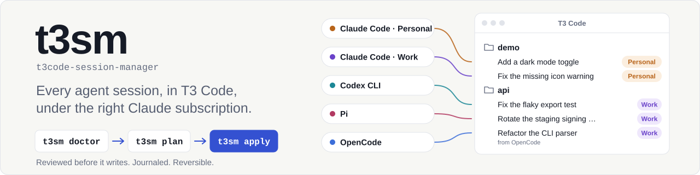
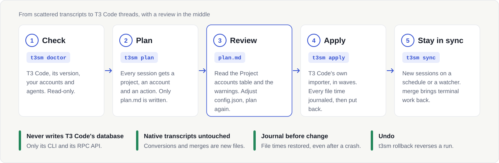
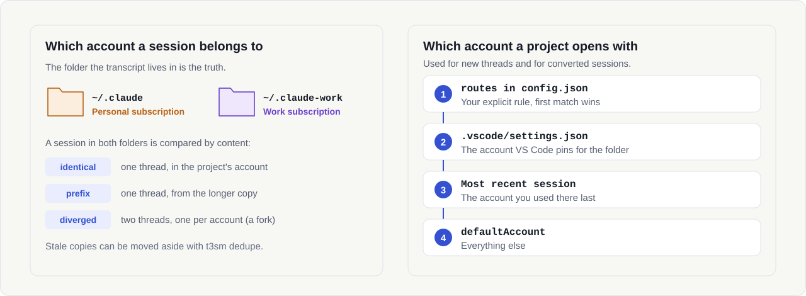

<picture>
  <source media="(max-width: 600px) and (prefers-color-scheme: dark)" srcset="docs/assets/hero-narrow-dark.svg">
  <source media="(max-width: 600px)" srcset="docs/assets/hero-narrow-light.svg">
  <source media="(prefers-color-scheme: dark)" srcset="docs/assets/hero-dark.svg">
  
</picture>

<p align="center">
  <a href="https://github.com/brunobola-portfolio/t3code-session-manager/actions/workflows/ci.yml"></a>
  <a href="LICENSE"></a>
  
  
  
  ·&nbsp;<a href="README.pt.md">Português</a>
</p>

**t3sm** puts every session from every coding agent and every Claude account into
[T3 Code](https://t3.codes), as threads you can resume, each under the subscription it
was run with. T3 Code is an open-source (MIT) desktop app for coding agents such as
Claude Code and Codex: you need it installed and running.

Your history is scattered across VS Code windows, Claude accounts and agents, and T3
Code's own import takes only the last 30 days, 100 sessions at a time, without knowing
which subscription each project belongs to. t3sm brings all of it in, reviewed first.

## Quick start

You need Node.js 22.18+, git, and T3 Code open. Open it from the Start menu or your
desktop launcher, not from a terminal that sets `CLAUDE_CONFIG_DIR`.

**1. Install once.** The same line on Windows, macOS and Linux:

```bash
npm install -g --install-links github:brunobola-portfolio/t3code-session-manager#v0.2.1
```

**2. Run it:**

```bash
t3sm
```

The guided set-up takes it from there: check, plan, a pilot project, the full import and
background sync. It explains each step and asks before every write. Stop at any question,
then run `t3sm` again to continue. For Portuguese, run `t3sm start --lang pt`.

**3. Update** later with `t3sm update`. Your settings and run history carry over.

<details>
<summary><b>Prefer to run each step yourself?</b></summary>

```bash
t3sm doctor                        # check: warnings are fine; a "fail" line says how to fix it
t3sm plan                          # writes plan.md and prints its path: read it
t3sm apply --dry-run               # what apply would do (writes nothing)
t3sm apply --only "C:/work/demo"   # pilot one project
t3sm apply                         # everything
```

If the plan lists **mirror copies** or doctor reports **backup folders**, run `t3sm dedupe`
or `t3sm quarantine` before `apply`, each with `--dry-run` first (reversible; see
[Choosing your subscription](#choosing-your-subscription)). `apply` shows the summary
and waits for `yes`. In `plan.md`, check the **Project accounts** table: it says which
subscription each project will use. Step by step, with every check:
[docs/switching-from-vscode.md](docs/switching-from-vscode.md).

</details>

No install at all? `npx -y github:brunobola-portfolio/t3code-session-manager#v0.2.1 <command>`
runs any command (background sync needs the installed one). To be strict about what you
run, pin a commit instead of the tag (`#<commit sha>`). Other sources:
[docs/migrate/](docs/migrate/claude-code.md). In Claude Code you can also ask for it in
plain words with the bundled skill ([docs/install.md](docs/install.md#claude-code-plugin)).

### First run checklist

- **Keep the machine awake** until `apply` finishes. If it sleeps during an import, t3sm
  stops that batch when it wakes, puts its file times back, and leaves the rest for the
  next run.
- **Close the sessions** of the projects you want imported. A project with a session
  written in the last 10 minutes waits for a later run.
- **Pause cloud sync of your home folder** (OneDrive, Dropbox, iCloud) during the first
  `apply`. A sync client can lock transcripts (t3sm then holds those projects for the
  run) or copy files while their times are moved.
- **Install the schedule only after the first full `apply`**: `sync` imports nothing
  while more than 200 sessions are pending.
- **Always name the run you undo:** `t3sm rollback --run <id>` (`t3sm runs` lists them).
  With `--yes`, `--run` is required, so a scheduled `sync` is never undone by mistake.
- If a run is interrupted (crash, power cut), the next t3sm command puts every moved
  file time back first. `t3sm doctor --repair` does only that.

<p align="center">
<picture>
  <source media="(prefers-reduced-motion: reduce) and (prefers-color-scheme: dark)" srcset="docs/assets/demo-static-dark.svg">
  <source media="(prefers-reduced-motion: reduce)" srcset="docs/assets/demo-static-light.svg">
  <source media="(prefers-color-scheme: dark)" srcset="docs/assets/demo-dark.svg">
  
</picture>
<br><sub>Synthetic demo: the <code>plan</code> summary, then <code>apply</code> importing in four waves.</sub>
</p>

## Check that it worked

- `apply` ends with a line like `Imported 412, failed 0, converted 6. Run 20261111-093125-c3d4.`
  and exit code 0. That run id is what `t3sm runs` lists and `t3sm rollback` takes.
- In T3 Code, each project of the plan is in the sidebar with its old sessions as
  threads. Opening a thread shows its history. Sending a message continues the original
  session, as a real turn on that thread's account (it uses your subscription).
- New threads in a project open with the account from the **Project accounts** table.
- `t3sm plan` again shows those sessions under `already-in-t3`, and `t3sm doctor` has no
  `fail`. `t3sm runs` lists what was done:

```text
Run                   Started                   Command                            Status  Changes
20261111-094501-7f3a  2026-11-11T09:45:01.000Z  quarantine                         ok      quarantined 2
20261111-100003-b2d4  2026-11-11T10:00:03.000Z  apply 20261111-093012-a1b2 --only  ok      imported 18, defaults 1, instances 1, projects 1
20261111-101544-c3d4  2026-11-11T10:15:44.000Z  apply 20261111-093012-a1b2         ok      imported 394, files 6, defaults 11, projects 11
```

<sub>Real output of `t3sm runs` on a synthetic journal.</sub>

## The problem it solves

You work in several VS Code windows, each with the Claude Code extension, and you have
two Claude subscriptions, say a personal one in `~/.claude` and a work one in
`~/.claude-work`. Your history is split by account, by window and by agent, and the
same session can exist twice, once per account. T3 Code can import sessions, but only
the last 30 days, at most 100 per click, from the accounts it already knows, and
nothing tells it which subscription a project belongs to.

t3sm finds every session on the machine, decides which account owns each one, creates
what T3 Code is missing, and has T3 Code import everything, whatever its age, in
reviewed batches. Afterwards it keeps T3 Code in step with work you do in a terminal.

## How it works

<picture>
  <source media="(max-width: 600px) and (prefers-color-scheme: dark)" srcset="docs/assets/flow-narrow-dark.svg">
  <source media="(max-width: 600px)" srcset="docs/assets/flow-narrow-light.svg">
  <source media="(prefers-color-scheme: dark)" srcset="docs/assets/flow-dark.svg">
  
</picture>

- **T3 Code imports, t3sm paces it.** Claude Code, Codex and Pi sessions are imported
  by T3 Code's own importer, so they resume natively. t3sm talks to T3 Code only
  through its `t3` CLI and its RPC API, never its database.
- **Old sessions without copies.** T3 Code imports only files touched in the last 30
  days. t3sm moves a batch's file times to "now" for a moment, imports, and puts them
  back. Every move is written to a journal first, and the next run repairs anything an
  interruption left behind.
- **One project at a time is safe.** T3 Code imports every recent transcript of a
  project at once, so t3sm parks the ones that should not go in (stale copies, excluded
  files, later batches) by setting their time 7 days **ahead**: Claude Code deletes
  old sessions by file time, so a parked file must never look old. A project with a
  session in use waits for the next run, and a batch interrupted by sleep stops and is
  retried.
- **Other agents are converted.** OpenCode sessions are written as Claude Code
  transcripts in the project's account, then imported like any Claude session. They
  resume in T3 Code and in `claude --resume`.
- **Everything is reviewable and reversible.** `plan` writes a report (and, on its
  first run, `config.json`) in t3sm's own folder and nothing else. `apply` asks first.
  `t3sm rollback` undoes a run. Details: [docs/architecture.md](docs/architecture.md).

## Choosing your subscription

<picture>
  <source media="(max-width: 600px) and (prefers-color-scheme: dark)" srcset="docs/assets/accounts-narrow-dark.svg">
  <source media="(max-width: 600px)" srcset="docs/assets/accounts-narrow-light.svg">
  <source media="(prefers-color-scheme: dark)" srcset="docs/assets/accounts-dark.svg">
  
</picture>

In T3 Code, an **instance** is one configured provider entry, such as "Claude" pointing at
one account folder. t3sm gives each Claude account its own instance, with its own name and
colour in T3 Code's model picker, so you choose the subscription per thread there, and
each project gets a default so new threads start on the right one. `apply` creates the
missing instances after you confirm the plan.

- **Discovered automatically.** From `~/.claude` and `~/.claude-*` folders,
  `CLAUDE_CONFIG_DIR` in shell aliases and functions (PowerShell, bash, zsh, fish), VS
  Code pins in `.vscode/settings.json`, the current shell and existing T3 Code instances.
  `t3sm accounts` shows what was found (emails masked; `--show-emails` for the full
  address). Optional: `t3sm accounts --init` writes the list to `config.json` so you can
  edit it, `--apply` creates the instances before any import (it asks first), and
  `--rename <id> "<name>" --color "#RRGGBB"` sets an instance's label in the picker.
- **A session keeps its account.** The folder a transcript lives in decides its account.
  A session copied into both accounts is compared: identical or shorter copies are
  mirrors (one thread), diverged ones are kept as two threads.
- **A project's default** comes from a `routes` rule, then the VS Code pin, then the
  account of the most recent session there, then `defaultAccount`.
- **The default instance is pinned.** If T3 Code's own Claude instance has no folder set in
  its settings, `apply` sets it to `~/.claude` (shown in the confirmation and in
  `apply --dry-run`), so a T3 Code started from a shell with `CLAUDE_CONFIG_DIR` cannot move
  it; until then `doctor` warns `instance-unpinned`. A session T3 Code already holds under
  another account is never imported a second time (`plan.md` lists it).
- **You can override it.** One line in `~/.t3code-session-manager/config.json`:

  ```json
  "routes": [{ "match": "C:/work/clients/**", "account": "claude-work" }]
  ```

Mirror copies matter because T3 Code's own Welcome import could pick a stale copy up under
the wrong account. `t3sm dedupe` moves them, and `t3sm quarantine` moves `.bak` folders
inside `projects/`, to a reversible quarantine. Sessions whose project folder no longer
exists are skipped as `cwd-missing`; if the project moved, a `remap` rule can point them
at the new folder (read its caveat first). More in [docs/accounts.md](docs/accounts.md)
and [docs/configuration.md](docs/configuration.md).

## Keeping in sync

```bash
t3sm sync                      # one cycle: import what is new since the last run
t3sm sync --watch              # stay resident and run a cycle when transcripts change
t3sm schedule install          # run sync every 15 minutes (Task Scheduler, launchd or cron)
t3sm schedule install --watch  # or start the watcher at logon
t3sm schedule status           # what is installed, last cycle
```

`sync` is built to run unattended, so it is cautious: it never creates instances or moves
files, waits for projects with a session in use, and imports nothing when more than
[`sync.maxUnattendedImports`](docs/configuration.md#sync) (200) sessions are pending, so the
first big import is always a reviewed `apply`.

**Work continued in a terminal.** If you resume an imported session with
`claude --resume`, T3 Code does not see the new turns: it continues from the last message
it knows. `sync` and `doctor` report those sessions, and `t3sm merge` lists them.
`t3sm merge --all` writes a new session file next to the original with the complete
branch, imports it as a new thread and archives the old thread. The original file is never
edited, and `t3sm rollback` undoes it. Compacted sessions are not merged, and terminal work
on a side branch (not the one `claude --resume` continues) is listed with a hint, never
merged.

## Other commands

| Command | What it does |
| :-- | :-- |
| `t3sm scan` | Counts the sessions per agent and account, without T3 Code; it writes only t3sm's discovery cache. **Flagged** counts sessions with a remark (in use, a corrupt line, no folder, a backup or compressed copy, a sub-agent…); `plan.md` says what happens to each |
| `t3sm runs` | Lists the runs in the journal (sample above) |
| `t3sm rollback --run <id>` | Undoes a run; `--dry-run` lists what it would undo. `--yes` requires `--run` |
| `t3sm doctor --repair` | Puts back file times an interrupted run left moved; the only write `doctor` makes |
| `t3sm accounts` | Accounts found and their T3 Code instances |
| `t3sm projects` | Every project folder with its account and why; `projects set "<folder>" <account>` changes it (a route, and the T3 Code project's default, reversible); `projects unset` removes the route |
| `t3sm start` | The guided assistant (also plain `t3sm` on a terminal); only it is translated (`--lang pt`), every other command prints English |
| `t3sm update` | Installs the newest release over an npm install (asks first; `--dry-run` prints the npm command). A git checkout or npx only gets instructions |

Every command has `--help`. What each skip reason in `plan.md` means is written next to it there, and in
[docs/troubleshooting.md](docs/troubleshooting.md).

## Safety

In short: t3sm shows you what it will do before it does it, never touches T3 Code's
database or the content of your transcripts, records every change before making it, and
can undo a run. Each guarantee is pinned by tests you can read and run (`npm test`):

- **Review before write.** `plan` writes only its report (plus, on first run,
  `config.json` and a discovery cache) in t3sm's folder. `apply`, `dedupe`, `quarantine`,
  `merge` and `rollback` ask first, and refuse with exit code 2 on a non-terminal without
  `--yes`. `apply --dry-run` runs every check and lists what it would do, writing nothing.
  [test/apply/apply.test.ts](test/apply/apply.test.ts),
  [test/apply/dry-run.test.ts](test/apply/dry-run.test.ts),
  [test/cli/ops.test.ts](test/cli/ops.test.ts)
- **Never writes T3 Code's database.** It uses the `t3` CLI and T3 Code's RPC API only, and
  reads one T3 Code file, `server-runtime.json`.
  [test/safety/boundaries.test.ts](test/safety/boundaries.test.ts)
- **Journal before change.** Every file time is recorded before it moves, and the run stops
  if the journal cannot be written.
  [test/apply/importer.test.ts](test/apply/importer.test.ts)
- **Restore on failure.** If an import throws, every file time is put back; after a crash,
  the next run (even with T3 Code closed) restores them first.
  [test/apply/importer.test.ts](test/apply/importer.test.ts),
  [test/core/journal.test.ts](test/core/journal.test.ts),
  [test/ops/sync.test.ts](test/ops/sync.test.ts)
- **Parked files go forward, never back.** A parked transcript is set 7 days into the
  future, so Claude Code's cleanup of old sessions can never select it, and a batch stops
  if the clock jumps (the machine slept) before T3 Code could see a parked file.
  [test/apply/importer.test.ts](test/apply/importer.test.ts)
- **Native transcripts are never edited.** Conversions and merge revisions are new files;
  the original stays byte-identical. Sessions in use (written in the last 10 minutes) are
  not touched.
  [test/ops/merge.test.ts](test/ops/merge.test.ts),
  [test/apply/materialize.test.ts](test/apply/materialize.test.ts),
  [test/sources/opencode.test.ts](test/sources/opencode.test.ts)
- **Rollback.** `t3sm rollback` deletes the files a run wrote (unless edited since), moves
  quarantined folders back with their file times, restores project defaults, never leaves a
  session without an active thread, and running it twice changes nothing.
  [test/ops/rollback.test.ts](test/ops/rollback.test.ts)
- **One run at a time.** A lock keeps a scheduled sync away from a manual apply. A lock
  left by a run that died, or by one from before the last restart, is taken over.
  [test/core/lock.test.ts](test/core/lock.test.ts), [test/cli/sync.test.ts](test/cli/sync.test.ts)

What t3sm reads and writes, and where: [SECURITY.md](SECURITY.md).

## Works with

| Agent | Status | How | Notes |
| :-- | :-- | :-- | :-- |
| **Claude Code**, one or more accounts | ✅ verified live | T3 Code's importer | Two accounts discovered and planned live on a real machine; import, merge and rollback run live on synthetic sessions |
| **OpenCode** 1.19.5 | ✅ verified live | converted to Claude Code | Conversion and import run live on a synthetic session; real database discovery verified read-only |
| **Codex CLI** | 🟡 verified with fixtures | T3 Code's importer; compressed sessions converted to Claude Code | Plus discovery on real files; no live native import yet. Codex 0.167+ compresses older sessions (`.jsonl.zst`), which T3 Code cannot read: t3sm converts them into Claude threads (conversion and import run live on a synthetic compressed session; 108 real compressed files discovered read-only) |
| **Pi** | 🟡 verified with fixtures | T3 Code's importer | Plus discovery on real files; imported only when T3 Code has a Pi instance (enable Pi in T3 Code's settings, under providers; see [T3 Code's docs](https://github.com/pingdotgg/t3code/tree/main/docs/user)); not run live |
| Gemini CLI, Cursor, Copilot CLI, Cline, Crush, goose, Amp, Grok Build, Qwen Code, Kilo, Antigravity | ⏳ planned | conversion | [Help add one](docs/adding-a-harness.md) |

Tested live: T3 Code `0.1.9-nightly.20261110` and `.20261111` on Windows 11; `0.1.8` is
supported from reading its source; stable releases are not tested yet. Other builds of a
supported minor version run with a notice; anything else needs `--allow-untested`. macOS
and Linux are covered by unit tests in CI only. Versions, storage formats and caveats per
agent: [docs/harnesses.md](docs/harnesses.md).

## Residual limits

These come from T3 Code itself; t3sm reports them instead of working around them.

- T3 Code shows at most **200 visible messages** per imported thread. Resuming still uses
  the whole session.
- **Tool activity** (commands, file edits) is not in the imported timeline, only the
  conversation text.
- Imported threads show the **import time** as their last activity.
- **Compacted sessions** (`/compact` after the import) are not merged.
- A thread stays on the account its session was run with. To use the other subscription
  for the same work, start a new thread and pick it.

## Exit codes

| Code | Meaning |
| :-: | :-- |
| 0 | Done, nothing to do, or you answered no. Also when another t3sm run holds the lock: a scheduled `sync` that finds a manual `apply` running should stay quiet, not raise an alarm |
| 1 | Unexpected error, or a `doctor` check failed |
| 2 | Usage or `config.json` error; a writing command on a non-terminal without `--yes`; a plan refused as stale (older than 24 h or made for another T3 Code version); T3 Code's default instance reading another account folder (`instance-home-drift`) |
| 3 | T3 Code is not running, or stopped answering during the run |
| 4 | T3 Code version not tested (use `--allow-untested`), or an unexpected response from it |
| 5 | Finished, but some sessions could not be imported (listed; the next run retries) |
| 130 | Interrupted with Ctrl+C (file times restored) |

## FAQ

**Will it touch my Claude history?** It never edits a transcript. It changes a
transcript's file time for the length of a batch and restores it (journaled). It writes
new files only for conversions and merges, and moves files only when you run `dedupe` or
`quarantine`, both reversible.

**What if I continue a session in the terminal?** That works, but T3 Code will not see the
new turns until you run `t3sm merge`. Never have the same session open in T3 Code and a
terminal at the same time.

**Can I undo everything?** `t3sm runs` lists the runs and `t3sm rollback --run <id>` undoes
one. Imported threads are listed, not deleted; `--archive-threads` archives them, and you
can delete them in T3 Code.

**Does it need my Claude login or an API key?** No. It reads no Claude or API credentials
and never calls a model. T3 Code's instances use the logins you already have in each
account folder.

**How long does it take?** Planning is quick: in one real run on Windows 11, a plan of
about 3,800 imports across two accounts took 24 seconds (an illustration, not a
benchmark). `apply` works in waves of at most 5 projects and 50 sessions per project; no
full-size run has been timed yet (first figures will go into the CHANGELOG after the
pilot). Start with `t3sm apply --only <project folder>`.

**Can I use T3 Code or VS Code while `apply` runs?** Yes. A project with a session written
in the last 10 minutes is held and imported on a later run, so your work is never touched.
Do not open the same session in two places at once. Keep the machine awake: a batch
interrupted by sleep is stopped and retried on the next run.

**Can I keep using VS Code?** Yes, for anything T3 Code does not do. Just keep each session
in one place at a time. See [docs/switching-from-vscode.md](docs/switching-from-vscode.md).

**Is T3 Code's database safe?** t3sm never opens it. Projects, instances, defaults and
imports go through T3 Code's own CLI and API, so T3 Code makes every change itself.

**Is this an official T3 Code or Anthropic tool?** No. t3sm is an independent project, not
affiliated with or endorsed by T3 Code, Ping or Anthropic.

## Uninstall

```bash
t3sm schedule remove        # if you installed the background sync
t3sm rollback --run <id>    # optional: undo runs you no longer want (see t3sm runs)
```

Then `npm uninstall -g t3code-session-manager`, delete the state folder
`~/.t3code-session-manager/` (its `cache/opencode/` holds the stripped OpenCode copies),
and, once you are sure you do not need them, the quarantine folders
`~/.claude*/session-manager-quarantine/`. Threads already imported stay in T3 Code.

## Contributing

Issues and pull requests are welcome; start with [CONTRIBUTING.md](CONTRIBUTING.md).
Adding an agent is a self-contained task: [docs/adding-a-harness.md](docs/adding-a-harness.md).
Security reports: [SECURITY.md](SECURITY.md).
What comes next, and where help is wanted: [ROADMAP.md](ROADMAP.md).

## License

[MIT](LICENSE), © 2026 BolaLabs. Not affiliated with T3 Code or Anthropic.
