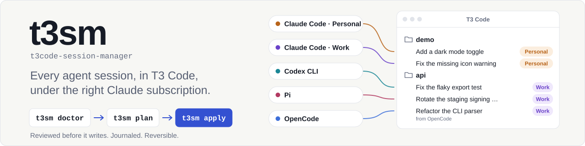
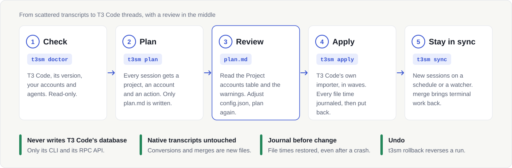
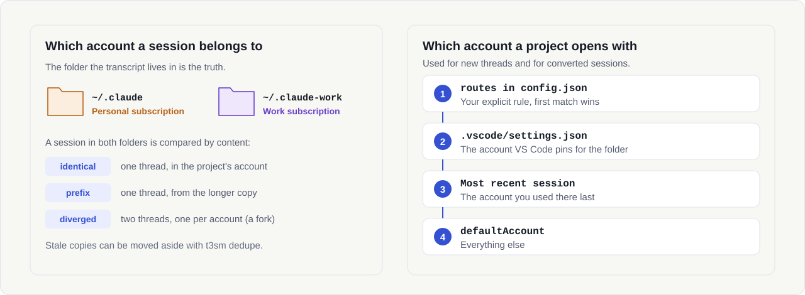

<picture>
  <source media="(max-width: 600px) and (prefers-color-scheme: dark)" srcset="docs/assets/hero-narrow-dark.svg">
  <source media="(max-width: 600px)" srcset="docs/assets/hero-narrow-light.svg">
  <source media="(prefers-color-scheme: dark)" srcset="docs/assets/hero-dark.svg">
  
</picture>

<p align="center">
  <a href="https://github.com/brunobola-portfolio/t3code-session-manager/actions/workflows/ci.yml"></a>
  <a href="LICENSE"></a>
  
  
  
  ·&nbsp;<a href="README.md">English</a>
</p>

O **t3sm** põe todas as sessões de todos os agentes de programação e de todas as contas Claude no
[T3 Code](https://t3.codes), como threads que podes retomar, cada uma na subscrição com que foi corrida. O T3 Code é
uma aplicação de secretária open source (MIT) para agentes de programação como o Claude Code e o Codex: precisas de o
ter instalado e a correr.

O teu histórico está espalhado por janelas de VS Code, contas Claude e agentes, e a importação do próprio T3 Code só
apanha os últimos 30 dias, 100 sessões de cada vez, sem saber a que subscrição pertence cada projeto. O t3sm traz tudo,
com revisão primeiro.

## Começar já

Precisas do Node.js 22.18+, do git e do T3 Code aberto. Abre-o pelo menu Iniciar ou pelo lançador do ambiente de
trabalho, não a partir de um terminal que defina `CLAUDE_CONFIG_DIR`.

**1. Instala uma vez.** A mesma linha no Windows, no macOS e no Linux:

```bash
npm install -g github:brunobola-portfolio/t3code-session-manager#v0.1.0
```

**2. Corre:**

```bash
t3sm start --lang pt
```

O assistente guiado faz o resto: verificação, plano, um projeto piloto, a importação completa e a sincronização em
segundo plano. Explica cada passo e pergunta antes de qualquer escrita. Podes parar em qualquer pergunta e voltar a
correr `t3sm` para continuar. Aceita guardar o português e, daí em diante, basta `t3sm`.

**3. Atualiza** mais tarde com `t3sm update`. As definições e o histórico de execuções mantêm-se.

<details>
<summary><b>Preferes correr cada passo tu mesmo?</b></summary>

```bash
t3sm doctor                        # verifica: avisos não fazem mal; uma linha "fail" diz como a resolver
t3sm plan                          # escreve o plan.md e mostra o caminho: lê-o
t3sm apply --dry-run               # o que o apply faria (não escreve nada)
t3sm apply --only "C:/work/demo"   # piloto num projeto
t3sm apply                         # tudo
```

Se o plano listar **cópias-espelho** (mirror copies) ou o doctor mostrar **pastas de backup**, corre o `t3sm dedupe`
ou o `t3sm quarantine` antes do `apply`, cada um primeiro com `--dry-run` (reversíveis; vê
[Escolher a subscrição](#escolher-a-subscrição)). O `apply` mostra o resumo e espera por `yes`. No `plan.md`, revê a
tabela **Project accounts**: diz que subscrição cada projeto vai usar. Passo a passo, com todas as verificações:
[docs/switching-from-vscode.pt.md](docs/switching-from-vscode.pt.md).

</details>

Sem instalar nada? `npx -y github:brunobola-portfolio/t3code-session-manager#v0.1.0 <comando>` corre qualquer
comando (a sincronização em segundo plano precisa do comando instalado). Para seres rigoroso com o que corres, fixa um
commit em vez da tag (`#<sha do commit>`). Outras origens: [docs/migrate/](docs/migrate/claude-code.pt.md). No Claude
Code também podes pedir em linguagem natural, com a skill incluída
([docs/install.md](docs/install.md#claude-code-plugin), em inglês).

### Lista para a primeira execução

- **Mantém a máquina acordada** até o `apply` terminar. Se ela suspender durante uma importação, o t3sm para esse lote
  quando acorda, repõe as datas dos ficheiros e deixa o resto para a execução seguinte.
- **Fecha as sessões** dos projetos que queres importar. Um projeto com uma sessão escrita nos últimos 10 minutos
  espera por uma execução seguinte.
- **Pausa a sincronização na nuvem da tua pasta pessoal** (OneDrive, Dropbox, iCloud) durante o primeiro `apply`. Um
  cliente de sincronização pode bloquear transcrições (o t3sm retém então esses projetos nessa execução) ou copiar
  ficheiros enquanto as datas estão mudadas.
- **Instala o agendamento só depois do primeiro `apply` completo**: o `sync` não importa nada enquanto houver mais de
  200 sessões pendentes.
- **Indica sempre a execução que desfazes:** `t3sm rollback --run <id>` (o `t3sm runs` lista-as). Com `--yes`, o
  `--run` é obrigatório, para que um `sync` agendado nunca seja desfeito por engano.
- Se uma execução for interrompida (falha, corte de energia), o próximo comando do t3sm repõe primeiro todas as datas
  mudadas. O `t3sm doctor --repair` faz só isso.

<p align="center">
<picture>
  <source media="(prefers-reduced-motion: reduce) and (prefers-color-scheme: dark)" srcset="docs/assets/demo-static-dark.svg">
  <source media="(prefers-reduced-motion: reduce)" srcset="docs/assets/demo-static-light.svg">
  <source media="(prefers-color-scheme: dark)" srcset="docs/assets/demo-dark.svg">
  
</picture>
<br><sub>Demonstração sintética: o resumo do <code>plan</code> e depois o <code>apply</code> a importar em quatro vagas.</sub>
</p>

## Confirmar que funcionou

- O `apply` termina com uma linha como `Imported 412, failed 0, converted 6. Run 20261111-093125-c3d4.` e código de
  saída 0. Esse id de execução é o que o `t3sm runs` lista e o `t3sm rollback` recebe.
- No T3 Code, cada projeto do plano está na barra lateral, com as sessões antigas como threads. Abrir uma thread
  mostra o histórico. Enviar uma mensagem continua a sessão original, como um turno real na conta dessa thread (gasta
  da tua subscrição).
- As threads novas de um projeto abrem com a conta da tabela **Project accounts**.
- Um novo `t3sm plan` mostra essas sessões em `already-in-t3`, e o `t3sm doctor` não tem nenhum `fail`. O `t3sm runs`
  lista o que foi feito:

```text
Run                   Started                   Command                            Status  Changes
20261111-094501-7f3a  2026-11-11T09:45:01.000Z  quarantine                         ok      quarantined 2
20261111-100003-b2d4  2026-11-11T10:00:03.000Z  apply 20261111-093012-a1b2 --only  ok      imported 18, defaults 1, instances 1, projects 1
20261111-101544-c3d4  2026-11-11T10:15:44.000Z  apply 20261111-093012-a1b2         ok      imported 394, files 6, defaults 11, projects 11
```

<sub>Saída real do `t3sm runs` sobre um journal sintético.</sub>

## O problema que resolve

Trabalhas em várias janelas de VS Code, cada uma com a extensão do Claude Code, e tens duas subscrições Claude, por
exemplo uma pessoal em `~/.claude` e uma de trabalho em `~/.claude-work`. O teu histórico fica partido por conta, por
janela e por agente, e a mesma sessão pode existir duas vezes, uma em cada conta. O T3 Code sabe importar sessões, mas
só as dos últimos 30 dias, no máximo 100 de cada vez, das contas que já conhece, e nada lhe diz a que subscrição
pertence cada projeto.

O t3sm encontra todas as sessões da máquina, decide a que conta pertence cada uma, cria o que falta no T3 Code e põe o
T3 Code a importar tudo, seja qual for a idade, em lotes revistos. Depois, mantém o T3 Code a par do trabalho que fazes
no terminal.

## Como funciona

<picture>
  <source media="(max-width: 600px) and (prefers-color-scheme: dark)" srcset="docs/assets/flow-narrow-dark.svg">
  <source media="(max-width: 600px)" srcset="docs/assets/flow-narrow-light.svg">
  <source media="(prefers-color-scheme: dark)" srcset="docs/assets/flow-dark.svg">
  
</picture>

- **O T3 Code importa, o t3sm dá o ritmo.** As sessões do Claude Code, do Codex e do Pi são importadas pelo próprio
  importador do T3 Code, por isso retomam-se de forma nativa. O t3sm fala com o T3 Code apenas pela CLI `t3` e pela
  API RPC, nunca pela base de dados.
- **Sessões antigas sem cópias.** O T3 Code só importa ficheiros alterados nos últimos 30 dias. O t3sm põe a data dos
  ficheiros de um lote em "agora" por um instante, importa e repõe-na. Cada mudança fica escrita primeiro num journal,
  e a execução seguinte repara o que uma interrupção tenha deixado.
- **Um projeto de cada vez, em segurança.** O T3 Code importa de uma vez todas as transcrições recentes de um projeto,
  por isso o t3sm estaciona as que não devem entrar (cópias desatualizadas, ficheiros excluídos, lotes seguintes)
  pondo-lhes a data 7 dias **à frente**: o Claude Code apaga sessões antigas pela data do ficheiro, por isso um
  ficheiro estacionado nunca pode parecer antigo. Um projeto com uma sessão em uso espera pela execução seguinte, e um
  lote interrompido por uma suspensão para e é repetido.
- **Os outros agentes são convertidos.** As sessões do OpenCode são escritas como transcrições do Claude Code na conta
  do projeto e depois importadas como qualquer sessão Claude. Retomam-se no T3 Code e com `claude --resume`.
- **Tudo é revisível e reversível.** O `plan` escreve um relatório (e, na primeira vez, o `config.json`) na pasta do
  próprio t3sm e mais nada. O `apply` pergunta primeiro. O `t3sm rollback` desfaz uma execução. Pormenores:
  [docs/architecture.md](docs/architecture.md) (em inglês).

## Escolher a subscrição

<picture>
  <source media="(max-width: 600px) and (prefers-color-scheme: dark)" srcset="docs/assets/accounts-narrow-dark.svg">
  <source media="(max-width: 600px)" srcset="docs/assets/accounts-narrow-light.svg">
  <source media="(prefers-color-scheme: dark)" srcset="docs/assets/accounts-dark.svg">
  
</picture>

No T3 Code, uma **instância** é uma entrada de fornecedor configurada, como "Claude" a apontar para uma pasta de conta.
O t3sm dá a cada conta Claude a sua instância, com nome e cor próprios no seletor de modelo do T3 Code, por isso
escolhes a subscrição por thread nesse seletor, e cada projeto tem uma conta por omissão para as threads novas
começarem na certa. O `apply` cria as instâncias em falta depois de confirmares o plano.

- **Descobertas automaticamente.** Nas pastas `~/.claude` e `~/.claude-*`, em `CLAUDE_CONFIG_DIR` dentro de aliases e
  funções da shell (PowerShell, bash, zsh, fish), nos pins do VS Code em `.vscode/settings.json`, na shell atual e nas
  instâncias que o T3 Code já tem. O `t3sm accounts` mostra o que encontrou (emails mascarados; `--show-emails` mostra
  o endereço completo). Opcional: o `t3sm accounts --init` escreve a lista no `config.json` para a poderes editar, o
  `--apply` cria as instâncias antes de qualquer importação (pergunta primeiro) e o
  `--rename <id> "<nome>" --color "#RRGGBB"` define o rótulo de uma instância no seletor.
- **Uma sessão mantém a sua conta.** A pasta onde está a transcrição decide a conta. Uma sessão copiada para as duas
  contas é comparada: cópias idênticas ou mais curtas são espelhos (uma thread), as divergentes ficam como duas
  threads.
- **A conta por omissão de um projeto** vem de uma regra em `routes`, depois do pin do VS Code, depois da conta da
  sessão mais recente nesse projeto, depois de `defaultAccount`.
- **A instância por omissão fica fixada.** Se a instância Claude do próprio T3 Code não tiver uma pasta definida nas
  definições, o `apply` fixa-a em `~/.claude` (mostrado na confirmação e no `apply --dry-run`), para que um T3 Code
  aberto a partir de uma shell com `CLAUDE_CONFIG_DIR` não a possa mudar; até lá, o `doctor` avisa com
  `instance-unpinned`. Uma sessão que o T3 Code já tenha noutra conta nunca é importada uma segunda vez (o `plan.md`
  lista-a).
- **Podes mudá-la.** Uma linha em `~/.t3code-session-manager/config.json`:

  ```json
  "routes": [{ "match": "C:/work/clients/**", "account": "claude-work" }]
  ```

As cópias-espelho importam porque a importação Welcome do próprio T3 Code poderia apanhar uma cópia desatualizada na
conta errada. O `t3sm dedupe` move-as, e o `t3sm quarantine` move as pastas `.bak` dentro de `projects/`, para uma
quarentena reversível. As sessões cuja pasta de projeto já não existe ficam de fora como `cwd-missing`; se o projeto
mudou de sítio, uma regra `remap` pode apontá-las para a pasta nova (lê primeiro a ressalva). Mais em
[docs/accounts.md](docs/accounts.md) e [docs/configuration.md](docs/configuration.md) (em inglês).

## Manter sincronizado

```bash
t3sm sync                      # um ciclo: importa o que é novo desde a última execução
t3sm sync --watch              # fica a correr e faz um ciclo quando as transcrições mudam
t3sm schedule install          # corre o sync a cada 15 minutos (Agendador de Tarefas, launchd ou cron)
t3sm schedule install --watch  # ou arranca o vigilante no início de sessão
t3sm schedule status           # o que está instalado, último ciclo
```

O `sync` foi feito para correr sem ninguém a ver, por isso é cauteloso: nunca cria instâncias nem move ficheiros,
espera pelos projetos com uma sessão em uso e não importa nada quando há mais de
[`sync.maxUnattendedImports`](docs/configuration.md#sync) (200) sessões pendentes, por isso a primeira importação
grande é sempre um `apply` revisto.

**Trabalho continuado no terminal.** Se retomares uma sessão importada com `claude --resume`, o T3 Code não vê os
turnos novos: continua a partir da última mensagem que conhece. O `sync` e o `doctor` avisam dessas sessões, e o
`t3sm merge` lista-as. O `t3sm merge --all` escreve um ficheiro de sessão novo ao lado do original com o ramo
completo, importa-o como thread nova e arquiva a thread antiga. O ficheiro original nunca é editado, e o
`t3sm rollback` desfaz tudo. As sessões compactadas não são integradas, e o trabalho do terminal num ramo lateral (não
o que o `claude --resume` continua) é listado com uma indicação, nunca integrado.

## Outros comandos

| Comando | O que faz |
| :-- | :-- |
| `t3sm scan` | Conta as sessões por agente e por conta, sem o T3 Code; só escreve a cache de descoberta do t3sm. **Flagged** conta as sessões com uma observação (em uso, uma linha corrompida, sem pasta, uma cópia de backup ou comprimida, um sub-agente…); o `plan.md` diz o que acontece a cada uma |
| `t3sm runs` | Lista as execuções do journal (exemplo acima) |
| `t3sm rollback --run <id>` | Desfaz uma execução; `--dry-run` lista o que desfaria. O `--yes` exige `--run` |
| `t3sm doctor --repair` | Repõe as datas dos ficheiros que uma execução interrompida deixou mudadas; é a única escrita do `doctor` |
| `t3sm accounts` | Contas encontradas e as respetivas instâncias no T3 Code |
| `t3sm projects` | Cada pasta de projeto com a sua conta e porquê; `projects set "<pasta>" <conta>` muda-a (uma rota, e a conta por omissão do projeto no T3 Code, reversível); `projects unset` remove a rota |
| `t3sm start` | O assistente guiado (também `t3sm` sozinho num terminal); só ele está traduzido (`--lang pt`), os outros comandos escrevem em inglês |
| `t3sm update` | Instala a versão mais recente sobre uma instalação npm (pergunta primeiro; `--dry-run` mostra o comando npm). Num clone git ou com npx só dá instruções |

Todos os comandos têm `--help`. O significado de cada razão para ignorar uma sessão está escrito ao lado dela no `plan.md` e em
[docs/troubleshooting.md](docs/troubleshooting.md) (em inglês).

## Segurança

Em resumo: o t3sm mostra-te o que vai fazer antes de o fazer, nunca mexe na base de dados do T3 Code nem no conteúdo
das tuas transcrições, regista cada mudança antes de a fazer e consegue desfazer uma execução. Cada garantia está
fixada por testes que podes ler e correr (`npm test`):

- **Rever antes de escrever.** O `plan` só escreve o seu relatório (e, na primeira vez, o `config.json` e uma cache de
  descoberta) na pasta do t3sm. O `apply`, o `dedupe`, o `quarantine`, o `merge` e o `rollback` perguntam primeiro, e
  recusam com o código 2 fora de um terminal sem `--yes`. O `apply --dry-run` faz todas as verificações e lista o que
  faria, sem escrever nada.
  [test/apply/apply.test.ts](test/apply/apply.test.ts),
  [test/apply/dry-run.test.ts](test/apply/dry-run.test.ts),
  [test/cli/ops.test.ts](test/cli/ops.test.ts)
- **Nunca escreve na base de dados do T3 Code.** Usa apenas a CLI `t3` e a API RPC do T3 Code, e lê um único ficheiro
  do T3 Code, o `server-runtime.json`.
  [test/safety/boundaries.test.ts](test/safety/boundaries.test.ts)
- **Journal antes de mudar.** Cada data de ficheiro é registada antes de mudar, e a execução para se o journal não
  puder ser escrito.
  [test/apply/importer.test.ts](test/apply/importer.test.ts)
- **Repor em caso de falha.** Se uma importação falhar, todas as datas são repostas; depois de uma falha grave, a
  execução seguinte (mesmo com o T3 Code fechado) repõe-nas primeiro.
  [test/apply/importer.test.ts](test/apply/importer.test.ts),
  [test/core/journal.test.ts](test/core/journal.test.ts),
  [test/ops/sync.test.ts](test/ops/sync.test.ts)
- **Os ficheiros estacionados vão para a frente, nunca para trás.** Uma transcrição estacionada fica com a data 7 dias
  no futuro, por isso a limpeza de sessões antigas do Claude Code nunca a pode escolher, e um lote para se o relógio
  saltar (a máquina suspendeu) antes de o T3 Code poder ver um ficheiro estacionado.
  [test/apply/importer.test.ts](test/apply/importer.test.ts)
- **As transcrições nativas nunca são editadas.** Conversões e revisões de merge são ficheiros novos; o original fica
  igual byte a byte. As sessões em uso (escritas nos últimos 10 minutos) não são tocadas.
  [test/ops/merge.test.ts](test/ops/merge.test.ts),
  [test/apply/materialize.test.ts](test/apply/materialize.test.ts),
  [test/sources/opencode.test.ts](test/sources/opencode.test.ts)
- **Rollback.** O `t3sm rollback` apaga os ficheiros que uma execução escreveu (se não foram editados desde então),
  devolve as pastas da quarentena com as datas originais, repõe as contas por omissão dos projetos, nunca deixa uma
  sessão sem uma thread ativa, e corrê-lo duas vezes não muda nada.
  [test/ops/rollback.test.ts](test/ops/rollback.test.ts)
- **Uma execução de cada vez.** Um lock impede que um sync agendado se cruze com um apply manual. Um lock deixado por
  uma execução que morreu, ou por uma de antes do último reinício, é retomado.
  [test/core/lock.test.ts](test/core/lock.test.ts), [test/cli/sync.test.ts](test/cli/sync.test.ts)

O que o t3sm lê e escreve, e onde: [SECURITY.md](SECURITY.md) (em inglês).

## Funciona com

| Agente | Estado | Como | Notas |
| :-- | :-- | :-- | :-- |
| **Claude Code**, uma ou mais contas | ✅ verificado ao vivo | importador do T3 Code | Duas contas descobertas e planeadas ao vivo numa máquina real; importação, merge e rollback corridos ao vivo com sessões sintéticas |
| **OpenCode** 1.19.5 | ✅ verificado ao vivo | convertido para Claude Code | Conversão e importação corridas ao vivo com uma sessão sintética; descoberta numa base de dados real verificada só em leitura |
| **Codex CLI** | 🟡 verificado com fixtures | importador do T3 Code; sessões comprimidas convertidas para Claude Code | Mais a descoberta em ficheiros reais; ainda sem importação nativa ao vivo. O Codex 0.167+ comprime as sessões mais antigas (`.jsonl.zst`), que o T3 Code não consegue ler: o t3sm converte-as em threads do Claude (conversão e importação corridas ao vivo com uma sessão comprimida sintética; 108 ficheiros comprimidos reais descobertos só em leitura) |
| **Pi** | 🟡 verificado com fixtures | importador do T3 Code | Mais a descoberta em ficheiros reais; só é importado quando o T3 Code tem uma instância Pi (ativa o Pi nas definições do T3 Code, nos fornecedores; vê a [documentação do T3 Code](https://github.com/pingdotgg/t3code/tree/main/docs/user)); não corrido ao vivo |
| Gemini CLI, Cursor, Copilot CLI, Cline, Crush, goose, Amp, Grok Build, Qwen Code, Kilo, Antigravity | ⏳ planeado | conversão | [Ajuda a acrescentar um](docs/adding-a-harness.md) |

Testado ao vivo: T3 Code `0.1.9-nightly.20261110` e `.20261111` no Windows 11; a `0.1.8` é suportada a partir da
leitura do código-fonte; as versões estáveis ainda não foram testadas. Outras builds de uma versão menor suportada
correm com um aviso; qualquer outra precisa de `--allow-untested`. O macOS e o Linux estão cobertos apenas pelos
testes unitários da CI. Versões, formatos de armazenamento e ressalvas por agente:
[docs/harnesses.md](docs/harnesses.md) (em inglês).

## Limites que ficam

Vêm do próprio T3 Code; o t3sm indica-os em vez de os contornar.

- O T3 Code mostra no máximo **200 mensagens visíveis** por thread importada. A retoma usa a sessão completa.
- A **atividade de ferramentas** (comandos, ficheiros editados) não aparece na timeline importada, só o texto da
  conversa.
- As threads importadas mostram a **hora da importação** como última atividade.
- As **sessões compactadas** (`/compact` depois da importação) não são integradas pelo merge.
- Uma thread fica na conta com que a sessão foi corrida. Para usar a outra subscrição no mesmo trabalho, começa uma
  thread nova e escolhe-a.

## Códigos de saída

| Código | Significado |
| :-: | :-- |
| 0 | Feito, nada a fazer, ou respondeste não. Também quando outra execução do t3sm tem o lock: um `sync` agendado que encontra um `apply` manual a correr deve ficar calado, não dar alarme |
| 1 | Erro inesperado, ou uma verificação do `doctor` falhou |
| 2 | Erro de utilização ou do `config.json`; um comando que escreve fora de um terminal sem `--yes`; um plano recusado por estar desatualizado (mais de 24 h ou feito para outra versão do T3 Code); a instância por omissão do T3 Code a ler outra pasta de conta (`instance-home-drift`) |
| 3 | O T3 Code não está a correr, ou deixou de responder durante a execução |
| 4 | Versão do T3 Code não testada (usa `--allow-untested`), ou uma resposta inesperada dele |
| 5 | Terminou, mas algumas sessões não foram importadas (listadas; a execução seguinte volta a tentar) |
| 130 | Interrompido com Ctrl+C (datas dos ficheiros repostas) |

## Perguntas frequentes

**Mexe no meu histórico do Claude?** Nunca edita uma transcrição. Muda a data de um ficheiro durante um lote e
repõe-na (com registo no journal). Só escreve ficheiros novos para conversões e merges, e só move ficheiros quando
corres o `dedupe` ou o `quarantine`, ambos reversíveis.

**E se continuar uma sessão no terminal?** Funciona, mas o T3 Code não vê os turnos novos até correres o
`t3sm merge`. Nunca tenhas a mesma sessão aberta ao mesmo tempo no T3 Code e num terminal.

**Posso desfazer tudo?** O `t3sm runs` lista as execuções e o `t3sm rollback --run <id>` desfaz uma. As threads
importadas são listadas, não apagadas; o `--archive-threads` arquiva-as, e podes apagá-las no T3 Code.

**Precisa do meu login do Claude ou de uma chave de API?** Não. Não lê credenciais do Claude nem chaves de API e nunca
chama um modelo. As instâncias do T3 Code usam os logins que já tens em cada pasta de conta.

**Quanto tempo demora?** Planear é rápido: numa execução real no Windows 11, um plano com cerca de 3800 importações em
duas contas demorou 24 segundos (uma ilustração, não um benchmark). O `apply` trabalha em vagas de no máximo 5
projetos e 50 sessões por projeto; ainda não foi cronometrada nenhuma execução completa (os primeiros números vão para
o CHANGELOG depois do piloto). Começa por `t3sm apply --only <pasta do projeto>`.

**Posso usar o T3 Code ou o VS Code enquanto o `apply` corre?** Sim. Um projeto com uma sessão escrita nos últimos 10
minutos fica retido e é importado numa execução seguinte, por isso o teu trabalho nunca é tocado. Não abras a mesma
sessão em dois sítios ao mesmo tempo. Mantém a máquina acordada: um lote interrompido por uma suspensão para e é
repetido na execução seguinte.

**Posso continuar a usar o VS Code?** Sim, para tudo o que o T3 Code não faz. Mantém só cada sessão num sítio de cada
vez. Vê [docs/switching-from-vscode.pt.md](docs/switching-from-vscode.pt.md).

**A base de dados do T3 Code fica segura?** O t3sm nunca a abre. Projetos, instâncias, contas por omissão e
importações passam pela CLI e pela API do próprio T3 Code, por isso é o T3 Code que faz cada alteração.

**É uma ferramenta oficial do T3 Code ou da Anthropic?** Não. O t3sm é um projeto independente, sem qualquer ligação
ao T3 Code, à Ping ou à Anthropic, nem aprovação destes.

## Desinstalar

```bash
t3sm schedule remove        # se instalaste a sincronização em segundo plano
t3sm rollback --run <id>    # opcional: desfaz execuções que já não queres (vê t3sm runs)
```

Depois corre `npm uninstall -g t3code-session-manager`, apaga a pasta de estado `~/.t3code-session-manager/` (a
`cache/opencode/` lá dentro guarda as cópias reduzidas do OpenCode) e, quando tiveres a certeza de que não precisas
delas, as pastas de quarentena `~/.claude*/session-manager-quarantine/`. As threads já importadas ficam no T3 Code.

## Contribuir

Issues e pull requests são bem-vindos; começa pelo [CONTRIBUTING.md](CONTRIBUTING.md). Acrescentar um agente é uma
tarefa autónoma: [docs/adding-a-harness.md](docs/adding-a-harness.md). Problemas de segurança:
[SECURITY.md](SECURITY.md).
O que vem a seguir, e onde a ajuda é bem-vinda: [ROADMAP.md](ROADMAP.md) (em inglês).

## Licença

[MIT](LICENSE), © 2026 BolaLabs. Sem ligação ao T3 Code nem à Anthropic.
