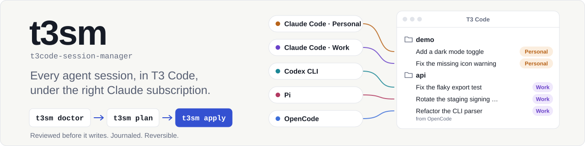
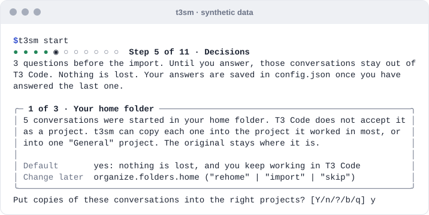
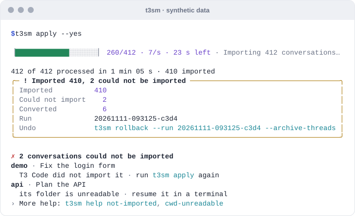
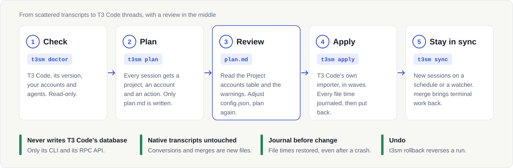
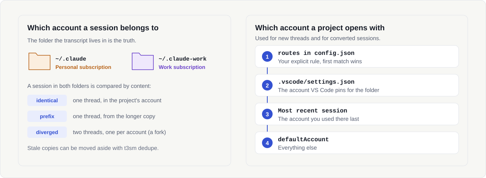
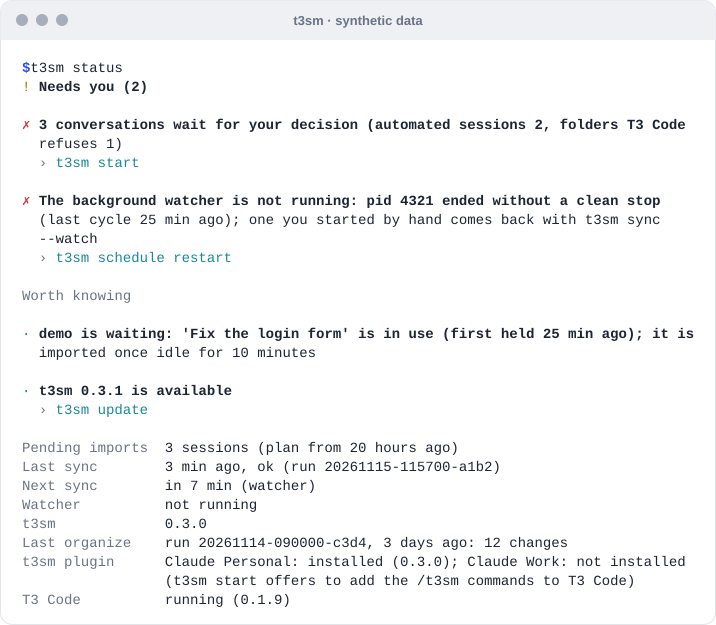

<picture>
  <source media="(max-width: 600px) and (prefers-color-scheme: dark)" srcset="docs/assets/hero-narrow-dark.svg">
  <source media="(max-width: 600px)" srcset="docs/assets/hero-narrow-light.svg">
  <source media="(prefers-color-scheme: dark)" srcset="docs/assets/hero-dark.svg">
  
</picture>

<p align="center">
  <a href="https://github.com/brunobola-portfolio/t3code-session-manager/actions/workflows/ci.yml"></a>
  <a href="LICENSE"></a>
  
  
  <a href="https://www.npmjs.com/package/t3code-session-manager"></a>
  
  ·&nbsp;<a href="README.md">English</a>
</p>

O **t3sm** põe todas as sessões de todos os agentes de programação e de todas as contas Claude no
[T3 Code](https://t3.codes), como threads que podes retomar, cada uma na subscrição com que foi corrida. O T3 Code é
uma aplicação de secretária open source (MIT) para agentes de programação como o Claude Code e o Codex: precisas de o
ter instalado e a correr.

O teu histórico está espalhado por janelas de VS Code, contas Claude e agentes, e a importação do próprio T3 Code só
apanha os últimos 30 dias, 100 sessões de cada vez, sem saber a que subscrição pertence cada projeto. O t3sm traz tudo,
com revisão primeiro.

## Começar já

Precisas do Node.js 22.18+ e do T3 Code aberto. Abre-o pelo menu Iniciar ou pelo lançador do ambiente de
trabalho, não a partir de um terminal que defina `CLAUDE_CONFIG_DIR`.

**1. Instala uma vez.** A mesma linha no Windows, no macOS e no Linux:

```bash
npm install -g t3code-session-manager
```

Cada versão no npm é construída pelo GitHub Actions a partir da sua etiqueta e assinada com
[proveniência](https://docs.npmjs.com/generating-provenance-statements) (o `npm audit signatures` confirma-a). A partir
do GitHub: `npm install -g --install-links github:brunobola-portfolio/t3code-session-manager#v0.5.0` (precisa do git).

**2. Corre:**

```bash
t3sm start --lang pt
```

O assistente guiado faz o resto: verificação, plano, as perguntas a que só tu podes responder, um projeto piloto, a
importação completa, a arrumação do histórico e a sincronização em segundo plano. Explica cada passo e pergunta antes
de qualquer escrita. Podes parar em qualquer pergunta e voltar a correr `t3sm` para continuar. Num sistema em português
o t3sm já fala português sem o `--lang pt`; aceita guardar a língua e, daí em diante, basta `t3sm`.

<picture>
  <source media="(max-width: 600px) and (prefers-color-scheme: dark)" srcset="docs/assets/screen-start-narrow-dark.svg">
  <source media="(max-width: 600px)" srcset="docs/assets/screen-start-narrow-light.svg">
  <source media="(prefers-color-scheme: dark)" srcset="docs/assets/screen-start-dark.svg">
  
</picture>

**3. As atualizações chegam sozinhas.** Com a sincronização em segundo plano instalada, o t3sm instala uma vez por dia
as versões de correção e as versões menores mais recentes e reinicia-se ([Atualizações
automáticas](#atualizações-automáticas)); o `t3sm update` fá-lo à mão. As definições e o histórico de execuções
mantêm-se.

<details>
<summary><b>Preferes correr cada passo tu mesmo?</b></summary>

```bash
t3sm doctor                        # verifica: avisos (!) não fazem mal; uma falha (✗) diz como a resolver
t3sm plan                          # escreve o plan.md e mostra o caminho: lê-o
t3sm apply --dry-run               # o que o apply faria (não escreve nada)
t3sm apply --only "C:/work/demo"   # piloto num projeto
t3sm apply                         # tudo
```

Se o plano listar **cópias-espelho** (mirror copies) ou o doctor mostrar **pastas de backup**, corre o `t3sm dedupe`
ou o `t3sm quarantine` antes do `apply`, cada um primeiro com `--dry-run` (reversíveis; vê
[Escolher a subscrição](#escolher-a-subscrição)). O `apply` mostra o resumo e espera por `yes`. No `plan.md`, revê a
tabela **Project accounts**: diz que subscrição cada projeto vai usar. Com milhares de sessões, o `t3sm plan --html`
escreve também o `plan.html` ao lado: um ficheiro local para abrir no browser, com filtros por projeto, conta, ação e
razão para ignorar e uma caixa de pesquisa (não carrega nada da rede). Passo a passo, com todas as verificações:
[docs/switching-from-vscode.pt.md](docs/switching-from-vscode.pt.md).

</details>

Sem instalar nada? `npx -y t3code-session-manager <comando>` corre qualquer comando (a sincronização em segundo plano
precisa do comando instalado). Para seres rigoroso com o que corres, fixa a versão (`t3code-session-manager@<versão>`). Outras origens: [docs/migrate/](docs/migrate/claude-code.pt.md). No Claude
Code também podes pedir em linguagem natural, com a skill incluída
([docs/install.md](docs/install.md#claude-code-plugin), em inglês).

### Lista para a primeira execução

- **Mantém a máquina acordada** até o `apply` terminar. Se ela suspender durante uma importação, o t3sm para esse lote
  quando acorda, repõe as datas dos ficheiros e deixa o resto para a execução seguinte.
- **Fecha as sessões** dos projetos que queres importar. Um projeto com uma sessão escrita nos últimos 10 minutos
  espera por uma execução seguinte.
- **Pausa a sincronização na nuvem da tua pasta pessoal** (OneDrive, Dropbox, iCloud) durante o primeiro `apply`. Um
  cliente de sincronização pode bloquear transcrições (o t3sm retém então esses projetos nessa execução) ou copiar
  ficheiros enquanto as datas estão mudadas.
- **Instala o agendamento só depois do primeiro `apply` completo**: o `sync` não importa nada enquanto houver mais de
  200 sessões pendentes.
- **Indica sempre a execução que desfazes:** `t3sm rollback --run <id>` (o `t3sm runs` lista-as). Com `--yes`, o
  `--run` é obrigatório, para que um `sync` agendado nunca seja desfeito por engano.
- Se uma execução for interrompida (falha, corte de energia), o próximo comando do t3sm repõe primeiro todas as datas
  mudadas. O `t3sm doctor --repair` faz só isso.

<p align="center">
<picture>
  <source media="(prefers-reduced-motion: reduce) and (prefers-color-scheme: dark)" srcset="docs/assets/demo-static-dark.svg">
  <source media="(prefers-reduced-motion: reduce)" srcset="docs/assets/demo-static-light.svg">
  <source media="(prefers-color-scheme: dark)" srcset="docs/assets/demo-dark.svg">
  
</picture>
<br><sub>Demonstração sintética: o resumo do <code>plan</code> e depois o <code>apply</code> a importar em quatro vagas.</sub>
</p>

## Confirmar que funcionou

<picture>
  <source media="(max-width: 600px) and (prefers-color-scheme: dark)" srcset="docs/assets/screen-import-narrow-dark.svg">
  <source media="(max-width: 600px)" srcset="docs/assets/screen-import-narrow-light.svg">
  <source media="(prefers-color-scheme: dark)" srcset="docs/assets/screen-import-dark.svg">
  
</picture>

- O `apply` importa atrás de uma barra de progresso e termina com um painel: o que foi importado, o que espera, o id
  da execução e o comando que a desfaz, e código de saída 0. Esse id de execução é o que o `t3sm runs` lista e o
  `t3sm rollback` recebe. As conversas que não puderam ser importadas aparecem por projeto e título, com o motivo em
  palavras (código 5); o `t3sm help <tópico>` explica cada motivo.
- No T3 Code, cada projeto do plano está na barra lateral, com as sessões antigas como threads. Abrir uma thread
  mostra o histórico. Enviar uma mensagem continua a sessão original, como um turno real na conta dessa thread (gasta
  da tua subscrição).
- As threads novas de um projeto abrem com a conta da tabela **Project accounts**.
- Um novo `t3sm plan` mostra essas sessões em `already-in-t3`, e o `t3sm doctor` não tem nenhuma falha (✗). O `t3sm runs`
  lista o que foi feito:

```text
Run                   Started                   Command                            Status  Changes
20261111-094501-7f3a  2026-11-11T09:45:01.000Z  quarantine                         ok      quarantined 2
20261111-100003-b2d4  2026-11-11T10:00:03.000Z  apply 20261111-093012-a1b2 --only  ok      imported 18, defaults 1, instances 1, projects 1
20261111-101544-c3d4  2026-11-11T10:15:44.000Z  apply 20261111-093012-a1b2         ok      imported 394, files 6, defaults 11, projects 11
```

<sub>Saída real do `t3sm runs` sobre um journal sintético.</sub>

## O problema que resolve

Trabalhas em várias janelas de VS Code, cada uma com a extensão do Claude Code, e tens duas subscrições Claude, por
exemplo uma pessoal em `~/.claude` e uma de trabalho em `~/.claude-work`. O teu histórico fica partido por conta, por
janela e por agente, e a mesma sessão pode existir duas vezes, uma em cada conta. O T3 Code sabe importar sessões, mas
só as dos últimos 30 dias, no máximo 100 de cada vez, das contas que já conhece, e nada lhe diz a que subscrição
pertence cada projeto.

O t3sm encontra todas as sessões da máquina, decide a que conta pertence cada uma, cria o que falta no T3 Code e põe o
T3 Code a importar tudo, seja qual for a idade, em lotes revistos. Depois, mantém o T3 Code a par do trabalho que fazes
no terminal, e pode arrumar o aspeto do histórico importado lá dentro.

## Como funciona

<picture>
  <source media="(max-width: 600px) and (prefers-color-scheme: dark)" srcset="docs/assets/flow-narrow-dark.svg">
  <source media="(max-width: 600px)" srcset="docs/assets/flow-narrow-light.svg">
  <source media="(prefers-color-scheme: dark)" srcset="docs/assets/flow-dark.svg">
  
</picture>

- **O T3 Code importa, o t3sm dá o ritmo.** As sessões do Claude Code, do Codex e do Pi são importadas pelo próprio
  importador do T3 Code, por isso retomam-se de forma nativa. O t3sm fala com o T3 Code apenas pela CLI `t3` e pela
  API RPC, nunca pela base de dados.
- **Sessões antigas sem cópias.** O T3 Code só importa ficheiros alterados nos últimos 30 dias. O t3sm põe a data dos
  ficheiros de um lote em "agora" por um instante, importa e repõe-na. Cada mudança fica escrita primeiro num journal,
  e a execução seguinte repara o que uma interrupção tenha deixado.
- **Um projeto de cada vez, em segurança.** O T3 Code importa de uma vez todas as transcrições recentes de um projeto,
  por isso o t3sm estaciona as que não devem entrar (cópias desatualizadas, ficheiros excluídos, lotes seguintes)
  pondo-lhes a data 7 dias **à frente**: o Claude Code apaga sessões antigas pela data do ficheiro, por isso um
  ficheiro estacionado nunca pode parecer antigo. Um projeto com uma sessão em uso espera pela execução seguinte, e um
  lote interrompido por uma suspensão para e é repetido.
- **Os outros agentes são convertidos.** As sessões do OpenCode são escritas como transcrições do Claude Code na conta
  do projeto e depois importadas como qualquer sessão Claude. Retomam-se no T3 Code e com `claude --resume`.
- **Tudo é revisível e reversível.** O `plan` escreve um relatório (e, na primeira vez, o `config.json`) na pasta do
  próprio t3sm e mais nada. O `apply` pergunta primeiro. O `t3sm rollback` desfaz uma execução. Pormenores:
  [docs/architecture.md](docs/architecture.md) (em inglês).

## Escolher a subscrição

<picture>
  <source media="(max-width: 600px) and (prefers-color-scheme: dark)" srcset="docs/assets/accounts-narrow-dark.svg">
  <source media="(max-width: 600px)" srcset="docs/assets/accounts-narrow-light.svg">
  <source media="(prefers-color-scheme: dark)" srcset="docs/assets/accounts-dark.svg">
  
</picture>

No T3 Code, uma **instância** é uma entrada de fornecedor configurada, como "Claude" a apontar para uma pasta de conta.
O t3sm dá a cada conta Claude a sua instância, com nome e cor próprios no seletor de modelo do T3 Code, por isso
escolhes a subscrição por thread nesse seletor, e cada projeto tem uma conta por omissão para as threads novas
começarem na certa. O `apply` cria as instâncias em falta depois de confirmares o plano.

- **Descobertas automaticamente.** Nas pastas `~/.claude` e `~/.claude-*`, em `CLAUDE_CONFIG_DIR` dentro de aliases e
  funções da shell (PowerShell, bash, zsh, fish), nos pins do VS Code em `.vscode/settings.json`, na shell atual e nas
  instâncias que o T3 Code já tem. O `t3sm accounts` mostra o que encontrou (emails mascarados; `--show-emails` mostra
  o endereço completo). Opcional: o `t3sm accounts --init` escreve a lista no `config.json` para a poderes editar, o
  `--apply` cria as instâncias antes de qualquer importação (pergunta primeiro) e o
  `--rename <id> "<nome>" --color "#RRGGBB"` define o rótulo de uma instância no seletor.
- **Uma sessão mantém a sua conta.** A pasta onde está a transcrição decide a conta. Uma sessão copiada para as duas
  contas é comparada: cópias idênticas ou mais curtas são espelhos (uma thread), as divergentes ficam como duas
  threads.
- **A conta por omissão de um projeto** vem de uma regra em `routes`, depois do pin do VS Code, depois da conta da
  sessão mais recente nesse projeto, depois de `defaultAccount`.
- **A instância por omissão fica fixada.** Se a instância Claude do próprio T3 Code não tiver uma pasta definida nas
  definições, o `apply` fixa-a em `~/.claude` (mostrado na confirmação e no `apply --dry-run`), para que um T3 Code
  aberto a partir de uma shell com `CLAUDE_CONFIG_DIR` não a possa mudar; até lá, o `doctor` avisa com
  `instance-unpinned`. Uma sessão que o T3 Code já tenha noutra conta nunca é importada uma segunda vez (o `plan.md`
  lista-a).
- **Podes mudá-la.** Uma linha em `~/.t3code-session-manager/config.json`:

  ```json
  "routes": [{ "match": "C:/work/clients/**", "account": "claude-work" }]
  ```

As cópias-espelho importam porque a importação Welcome do próprio T3 Code poderia apanhar uma cópia desatualizada na
conta errada. O `t3sm dedupe` move-as, e o `t3sm quarantine` move as pastas `.bak` dentro de `projects/`, para uma
quarentena reversível. As sessões cuja pasta de projeto já não existe ficam de fora como `cwd-missing`; se o projeto
mudou de sítio, uma regra `remap` pode apontá-las para a pasta nova (lê primeiro a ressalva). Mais em
[docs/accounts.md](docs/accounts.md) e [docs/configuration.md](docs/configuration.md) (em inglês).

## Manter sincronizado

```bash
t3sm sync                      # um ciclo: importa o que é novo desde a última execução
t3sm sync --watch              # fica a correr e faz um ciclo quando as transcrições mudam
t3sm schedule install          # corre o sync a cada 15 minutos (Agendador de Tarefas, launchd ou cron)
t3sm schedule install --watch  # ou arranca o vigilante no início de sessão
t3sm schedule status           # o que está instalado, último ciclo
```

O `sync` foi feito para correr sem ninguém a ver, por isso é cauteloso: nunca cria instâncias nem move ficheiros,
espera pelos projetos com uma sessão em uso e não importa nada quando há mais de
[`sync.maxUnattendedImports`](docs/configuration.md#sync) (200) sessões pendentes, por isso a primeira importação
grande é sempre um `apply` revisto. Nunca faz perguntas: as sessões de um tipo sobre o qual ainda não decidiste
esperam, e o `t3sm status` di-lo. O que faz sozinho, cada mudança registada no journal da execução do ciclo (o
`t3sm rollback --run <id>` desfá-la):

- arruma as conversas que acabou de importar (arquiva as automáticas, dá-lhes títulos legíveis);
- aplica a [regra do histórico](#a-regra-do-histórico) logo a seguir a uma importação e uma vez por dia, no máximo 200
  mudanças por ciclo, sem nunca mexer numa conversa que mudaste à mão;
- traz o que acrescentares ao original de uma [conversa copiada](#conversas-de-pastas-que-o-t3-code-recusa) fora do
  T3 Code;
- como vigilante, reinicia-se numa versão mais recente do t3sm depois do ciclo seguinte e procura
  [atualizações](#atualizações-automáticas) uma vez por dia.

**O vigilante em segundo plano.** O `t3sm schedule install --watch` arranca-o no início de sessão e, no Windows e no
Linux, confirma a cada 15 minutos que continua a correr (um que já esteja a correr fica como está; no macOS é o
launchd que o mantém vivo). O `t3sm schedule restart` para-o e volta a arrancá-lo; o `install` e o `remove` também o
param primeiro. O t3sm para um vigilante pedindo-lho pelo seu próprio canal autenticado e, só se isso falhar, pelo id
do processo, depois de confirmar que esse processo é um vigilante do t3sm arrancado à hora que o seu heartbeat indica.
Nunca pelo nome.

**Trabalho continuado no terminal.** Se retomares uma sessão importada com `claude --resume`, o T3 Code não vê os
turnos novos: continua a partir da última mensagem que conhece. O `sync` e o `doctor` avisam dessas sessões, e o
`t3sm merge` lista-as. O `t3sm merge --all` escreve um ficheiro de sessão novo ao lado do original com o ramo
completo, importa-o como thread nova e arquiva a thread antiga. O ficheiro original nunca é editado, e o
`t3sm rollback` desfaz tudo. As sessões compactadas não são integradas, e o trabalho do terminal num ramo lateral (não
o que o `claude --resume` continua) é listado com uma indicação, nunca integrado.

## Atualizações automáticas

Uma vez por dia o vigilante em segundo plano procura a versão mais recente da origem de onde o t3sm foi instalado: as
etiquetas `vX.Y.Z` do GitHub, ou as etiquetas `vX.Y.Z` no `main` de um clone neste computador
(`t3sm update --from <pasta>`). Uma versão de **correção ou menor** mais recente (incluindo as menores 0.x) é instalada
sozinha, num processo separado e escondido, e o vigilante reinicia-se nela. Uma versão **maior** só é anunciada
(`t3sm status`, uma notificação): o `t3sm update` instala-a depois de dizeres que sim.

- **Verificação e reposição.** Depois de uma instalação, o vigilante novo tem de escrever um heartbeat saudável em 2
  minutos. Se não escrever, o t3sm reinstala a versão anterior e reinicia-a: o t3sm recuperou sozinho, por isso o
  `t3sm status` mostra-o em "Bom saber", não como algo que precisa de ti. A procura automática passa a saltar essa
  versão; o `t3sm update` ainda a pode instalar de propósito.
- **Nunca volta atrás.** Só se instala uma versão estritamente mais recente do que a instalada.
- **No journal.** Cada atualização é uma entrada no journal (de, para, resultado). O `t3sm status` mostra uma
  atualização recente ("Updated to 0.3.1 yesterday", ou em português) e o `t3sm changelog` o que há de novo.
- **Desligar.** `t3sm update --auto off` (e `on`). Um clone git ou o `npx` nunca são atualizados sozinhos.

**A única ligação à rede.** Fora o T3 Code na tua própria máquina (só loopback), o t3sm contacta uma coisa: a procura
de versões (`npm view` no registo do npm, ou `git ls-remote` no GitHub para uma instalação a partir do GitHub), uma vez por dia pelo
vigilante e quando corres `t3sm update` ou `t3sm update --check`. Instalar uma versão corre o npm (e o git), que a
descarregam. A única outra vez em que algo vai à rede é a instalação opcional do plugin `/t3sm` no `t3sm start`,
depois do teu sim (comandos `claude plugin`). Nada sobre as tuas sessões é alguma vez enviado.

```bash
t3sm update --check            # instalada, mais recente, correção/menor/maior, origem, atualizações automáticas
t3sm update                    # o que há de novo, e depois pergunta
t3sm changelog                 # as notas da versão instalada
```

## Organizar o histórico

<picture>
  <source media="(max-width: 600px) and (prefers-color-scheme: dark)" srcset="docs/assets/organize-narrow-dark.svg">
  <source media="(max-width: 600px)" srcset="docs/assets/organize-narrow-light.svg">
  <source media="(prefers-color-scheme: dark)" srcset="docs/assets/organize-dark.svg">
  
</picture>

Importar não é o fim da história. O T3 Code só mostra dentro de um projeto as threads que não estão em Settled,
e as conversas importadas chegam em Settled, por isso ficam numa lista comprida, o **Settled**, e os teus
projetos parecem vazios. Num histórico real, cerca de 80% das sessões eram execuções de scripts (Agent SDK) e não
conversas. E o T3 Code não consegue importar conversas começadas na tua pasta pessoal nem em algumas outras pastas
(Downloads, `Documents/Codex`, a pasta temporária). As pastas temporárias e do sistema são ignoradas por omissão, não copiadas.

O `t3sm organize` arruma isto, depois de te mostrar o que faria. O t3sm é uma ferramenta pequena: usa só os comandos
que o T3 Code oferece para isto, e cada parte é opcional.

| Parte | O que faz | Por omissão |
| :-- | :-- | :-: |
| Sessões automáticas | Arquiva as começadas por scripts (Agent SDK), e as de um projeto que o t3sm criou numa pasta temporária ou do sistema | ligado |
| Títulos | Troca um título que é uma primeira mensagem técnica (`<command-name>`, `<ide_…>`) por um legível, com no máximo 80 carateres | ligado |
| Títulos escritos pelo T3 Code | Com `--ai-titles`: o T3 Code escreve, com o seu próprio modelo de texto, os títulos que continuam técnicos (sem primeira mensagem utilizável). Gasta tokens do teu fornecedor; o resumo diz primeiro quantos, o modelo e o limite (`--ai-titles-max`, 50 por execução). Nunca no `t3sm sync` | desligado |
| Histórico nos projetos | A [regra do histórico](#a-regra-do-histórico): os últimos 90 dias à vista dentro de cada projeto, pelo menos 10 por projeto, o resto em Settled. A passagem automática para Settled do T3 Code **não** muda, a não ser que peças | 90 dias, pelo menos 10 |
| Fixar | Fixa os 5 projetos com atividade mais recente, e deixa de fixar os que o t3sm fixou e já não estão entre eles | ligado |
| Projetos vazios | Apaga os projetos vazios que o t3sm criou | ligado |

```bash
t3sm organize --dry-run        # o que mudaria; não escreve nada
t3sm organize                  # a mesma lista, e depois pergunta
t3sm organize --undo           # repõe o que mudou (pergunta primeiro)
```

Cada tipo de mudança traz quantas são, porquê e como desfazer. Num terminal, o `d` na pergunta abre as mudanças como
uma lista onde podes desmarcar uma a uma. Opções: `--only "<pasta>"` (um projeto; sem fixar nem apagar), `--plain` (só
texto, sem ecrã interativo), `--no-pin <ids>`, `--no-delete`, `--no-archive-folders` (não arquiva as conversas dos
projetos que o t3sm criou em pastas temporárias ou de sistema), `--history <dias|all|off>` e `--min <n>` (a regra do
histórico só para esta execução) e `--auto-settle <1..90|off>`, se também quiseres que a opção do próprio T3 Code para
as conversas que lá começares fique nesse número de dias, ou desligada (fica registado, e o `--undo` desfaz). O
`--ai-titles` (com `--ai-titles-max <n>`) pede ao T3 Code os títulos que continuam técnicos; o `t3sm help ai-titles`
explica. Os valores por omissão e
as chaves do `config.json` estão em [docs/configuration.md](docs/configuration.md#organize) (em inglês). O assistente
guiado (`t3sm start`) faz as mesmas perguntas, uma de cada vez, com os teus números reais.

### A regra do histórico

O T3 Code só mostra dentro de um projeto as conversas que não estão em Settled; as que estão continuam ligadas ao
projeto, na prateleira **Settled** no fundo da barra lateral. A regra, por projeto:

- cada conversa com atividade nos últimos **90 dias** fica à vista;
- se isso deixar menos de **10** à vista, as mais recentes em Settled voltam a aparecer até serem 10 (conta tudo o que
  está à vista, incluindo as conversas que começaste no T3 Code e as fixadas);
- tudo o resto passa para Settled, das mais antigas para as mais recentes, para a prateleira manter a ordem do teu histórico.

Só as conversas importadas são mexidas (as threads `import:`, trazidas pelo t3sm ou pela importação do próprio T3
Code; as que começaste no T3 Code só a opção do T3 Code as move), e uma que passaste para Settled, mostraste, fixaste ou
arquivaste à mão nunca mais é tocada. A data de atividade é a do próprio T3 Code: a mensagem ou execução mais recente, senão quando a conversa
foi criada. O `organize.history` no `config.json` guarda os números (`{ "days": 1-3650 ou "all", "minPerProject":
0-1000 }`), o `t3sm organize --history <dias|all|off> --min <n>` usa outros numa execução, e o `t3sm sync` aplica a
regra uma vez por dia. Para as conversas que começas no T3 Code, o T3 Code tem a sua própria opção (passar para Settled ao fim de
1 a 90 dias sem uso): o assistente guiado oferece-se para a pôr nos mesmos dias, e o
`t3sm organize --auto-settle <1..90|off>` muda-a (fica no journal, e o `--undo` desfaz). O `t3sm help history`
explica-a em português.

**O que nunca toca:** conversas que começaste no T3 Code, projetos que criaste (a não ser para os fixar, e para deixar de fixar o que o t3sm fixou), as definições
do T3 Code (exceto `--auto-settle`, se pedires) e tudo o que mudaste à mão depois: uma conversa que
desarquivaste, renomeaste ou reabriste, um projeto que deixaste de fixar. Essa escolha fica tua para sempre. O
`t3sm rollback --run <id>` também desfaz uma execução do organize, exatamente como o `--undo`. Como desfazer muda o T3
Code, o `--undo --yes` exige o id da execução (`t3sm organize --undo <run> --yes`), como o `rollback`.

### Conversas de pastas que o T3 Code recusa

Por omissão, o t3sm copia-as, inteiras e sem alterações, para o projeto em que trabalharam. Lê os caminhos que a
conversa tocou: "63 de 80 caminhos estão em `~/code/billing-api`" chega (pelo menos 60% dos caminhos e pelo menos 5
ocorrências). Sem um projeto claro, vão para um projeto chamado **Geral** (`~/T3 Geral`; `~/T3 General` no assistente em
inglês), cuja pasta o `t3sm apply` cria quando falta (nunca o `sync`; o `rollback` volta a removê-la enquanto estiver
vazia). Uma pasta que o T3 Code recusa, ou uma pasta temporária ou de sistema, nunca é usada. O original nunca é
modificado, e o `rollback` remove a cópia. Se continuares a conversar no original **fora do T3 Code depois da
importação** (no VS Code, a partir da pasta pessoal), o `t3sm sync` faz a cópia seguir o original: quando o original e a
cópia estiverem parados há 10 minutos, escreve uma cópia nova com as mensagens novas, importa-a como thread nova com o
título e o estado da thread antiga, e só depois arquiva a thread antiga. Uma cópia que também continuaste no T3 Code
nunca é substituída: o `t3sm status` nomeia as duas, e és tu que escolhes. As pastas temporárias e do sistema, e as
sessões automáticas, são ignoradas por omissão. As regras podem mudar por pasta (`organize.overrides`), mas um override
nunca importa uma sessão automática (Agent SDK): essas são decididas por `organize.sessions.automated`.

**Conversas começadas no T3 Code** são reconhecidas e nunca voltam a ser importadas. Se apagaste a thread de uma delas
no T3 Code, o T3 Code recusa-se a importá-la outra vez: depois de uma pergunta (por omissão sim) o t3sm trá-la de volta
como cópia fiel com um id de sessão novo (`organize.sessions.orphaned`). Uma cuja thread o t3sm não consegue
identificar fica de fora e nunca é copiada, para uma conversa viva nunca ser duplicada.

### Saber o que precisa de ti

```bash
t3sm status                    # "All good", "Needs you (N)" com o comando de cada item, ou "Working"
```

<picture>
  <source media="(max-width: 600px) and (prefers-color-scheme: dark)" srcset="docs/assets/screen-status-narrow-dark.svg">
  <source media="(max-width: 600px)" srcset="docs/assets/screen-status-narrow-light.svg">
  <source media="(prefers-color-scheme: dark)" srcset="docs/assets/screen-status-dark.svg">
  
</picture>

O `t3sm status` só lê: não liga ao T3 Code e não escreve nada. Primeiro o que precisa de ti, cada item com o seu
comando: o vigilante que não corre, corre um t3sm antigo ou falha; uma atualização que falhou ou foi interrompida;
conversas à espera da tua decisão; conversas que continuam a falhar na importação; cópias continuadas em dois sítios;
mudanças do organize que não puderam ser feitas. Depois, em "Bom saber": os projetos **retidos** porque uma conversa
neles está em uso (são importados quando ela estiver parada há 10 minutos), uma atualização recente, uma atualização
desfeita (a versão anterior voltou a correr) ou uma versão nova, e o último e o próximo sync. Em português num sistema em português. O `--json` imprime o mesmo (em inglês) para scripts, e o código de saída é 10 quando algo precisa de ti (senão 0). Quando um `sync` agendado precisa de ti, pode mostrar uma notificação do
sistema (`notify` no `config.json`: `attention` por omissão, `all` ou `off`) só com nomes de projetos e contagens.

**Dentro do T3 Code.** O plugin `t3sm` junta `/t3sm:status`, `/t3sm:sync`, `/t3sm:organize` e `/t3sm:import` ao menu "/"
do T3 Code. Cada um mostra primeiro uma pré-visualização e só escreve depois de dizeres que sim. O `t3sm start` oferece
instalá-lo, por conta do Claude, depois de um `y`; ou corre tu `claude plugin install t3sm@t3code-session-manager` para
essa conta. A conversa que corre `/t3sm:sync` ou `/t3sm:import` conta como "em uso", por isso o seu projeto espera pelo
ciclo seguinte; o `/t3sm:organize` não espera por ela e pode dar-lhe um título novo ou mostrá-la dentro do projeto.

O t3sm não recusa uma versão do T3 Code que não testou: avisa uma vez e segue. Cada mudança fica no journal e pode ser
desfeita.

## Outros comandos

| Comando | O que faz |
| :-- | :-- |
| `t3sm scan` | Conta as sessões por agente e por conta, sem o T3 Code; só escreve a cache de descoberta do t3sm. **Flagged** conta as sessões com uma observação (em uso, uma linha corrompida, sem pasta, uma cópia de backup ou comprimida, um sub-agente…); o `plan.md` diz o que acontece a cada uma |
| `t3sm stats` | O que tens: sessões por agente, por conta do Claude Code e por mês, o que foi importado e convertido, e o que o último plano ignora. Contado na tua máquina e não enviado para lado nenhum (o t3sm não tem telemetria); só lê, não precisa do T3 Code; `--json` |
| `t3sm runs` | Lista as execuções do journal (exemplo acima) |
| `t3sm rollback --run <id>` | Desfaz uma execução; `--dry-run` lista o que desfaria. O `--yes` exige `--run` |
| `t3sm recover <id da sessão>` | Traz de volta uma conversa começada no T3 Code cuja thread apagaste, quando o t3sm não o consegue saber sozinho (o `t3sm status` lista-as): uma cópia fiel com um id novo, importada para o seu projeto. Se a thread ainda existir no T3 Code, isto cria um duplicado. Pergunta primeiro; `--dry-run`; desfaz-se com `rollback` |
| `t3sm doctor --repair` | Repõe as datas dos ficheiros que uma execução interrompida deixou mudadas; é a única escrita do `doctor` |
| `t3sm journal compact` | Torna o `journal.jsonl` mais pequeno: retira os registos de datas de ficheiros das execuções que terminaram há mais de 90 dias (`--older-than <dias>`) sem nada pendente, e guarda o journal antigo numa cópia de segurança ao lado. O `runs`, o `rollback`, o `organize --undo` e a recuperação veem a mesma história. Pergunta primeiro; `--dry-run` |
| `t3sm accounts` | Contas encontradas e as respetivas instâncias no T3 Code |
| `t3sm projects` | Cada pasta de projeto com a sua conta e porquê; `projects set "<pasta>" <conta>` muda-a (uma rota, e a conta por omissão do projeto no T3 Code, reversível); `projects unset` remove a rota; `projects rename --suggest` propõe nomes limpos para os projetos que o t3sm criou (antes -> depois, pergunta primeiro, desfeito pelo `organize --undo`) |
| `t3sm organize` | Arruma o histórico importado no T3 Code ([acima](#organizar-o-histórico)); `--dry-run`, `--undo`, `--only`, `--plain`, `--ai-titles` |
| `t3sm status` | Diz se o t3sm precisa de ti, e o que correr. Só lê; sai com 10 quando precisa de ti; `--json` |
| `t3sm start` | O assistente guiado (também `t3sm` sozinho num terminal) |
| `t3sm schedule` | `install [--watch]`, `remove`, `restart` (para e volta a arrancar o vigilante em segurança), `status`; os que escrevem perguntam, ou aceitam `--yes`, e têm `--dry-run` |
| `t3sm update` | Instala a versão mais recente, mostra o que há de novo e pergunta primeiro; `--check` só consulta, `--dry-run` mostra o que seria instalado, `--from <pasta>` instala a partir de um clone (fica lembrado), `--source npm` ou `--source github` escolhe de onde vêm as atualizações, `--auto on` / `--auto off` liga ou desliga a atualização automática diária. Num clone git ou com npx só dá instruções |
| `t3sm changelog` | O que há de novo na versão instalada (`--since <versão>` para várias versões). Só lê |
| `t3sm help [<tópico>]` | O que uma mensagem quer dizer, porque acontece e o que fazer (`not-imported`, `held`, `decisions`, `history`, `updates`, `watcher`, ...). Só lê |

Todos os comandos têm `--help` e aceitam `--lang en|pt` e `--no-color`. Sem `--lang`, o t3sm segue o `T3SM_LANG`,
depois o `"language"` do `config.json`, depois a língua do sistema, senão inglês. O `--json`, o `plan.md`, o `plan.html`, o
journal e o `logs/sync.log` ficam sempre em inglês. O significado de cada razão para ignorar uma sessão está escrito ao lado dela
no `plan.md`; cada ecrã que mostra um problema indica o tópico do `t3sm help` que o explica
([docs/troubleshooting.md](docs/troubleshooting.md), em inglês, é o índice).

## Segurança

Em resumo: o t3sm mostra-te o que vai fazer antes de o fazer, nunca mexe na base de dados do T3 Code nem no conteúdo
das tuas transcrições, regista cada mudança antes de a fazer e consegue desfazer uma execução. Cada garantia está
fixada por testes que podes ler e correr (`npm test`):

- **Rever antes de escrever.** O `plan` só escreve o seu relatório (e, na primeira vez, o `config.json` e uma cache de
  descoberta) na pasta do t3sm. O `apply`, o `dedupe`, o `quarantine`, o `merge`, o `organize`, o `rollback` e o `journal compact` perguntam primeiro, e
  recusam com o código 2 fora de um terminal sem `--yes`. O `apply --dry-run` faz todas as verificações e lista o que
  faria, sem escrever nada.
  [test/apply/apply.test.ts](test/apply/apply.test.ts),
  [test/apply/dry-run.test.ts](test/apply/dry-run.test.ts),
  [test/cli/ops.test.ts](test/cli/ops.test.ts)
- **Nunca escreve na base de dados do T3 Code.** Usa apenas a CLI `t3` e a API RPC do T3 Code, e lê um único ficheiro
  do T3 Code, o `server-runtime.json`.
  [test/safety/boundaries.test.ts](test/safety/boundaries.test.ts)
- **Journal antes de mudar.** Cada data de ficheiro é registada antes de mudar, e a execução para se o journal não
  puder ser escrito.
  [test/apply/importer.test.ts](test/apply/importer.test.ts)
- **Repor em caso de falha.** Se uma importação falhar, todas as datas são repostas; depois de uma falha grave, a
  execução seguinte (mesmo com o T3 Code fechado) repõe-nas primeiro.
  [test/apply/importer.test.ts](test/apply/importer.test.ts),
  [test/core/journal.test.ts](test/core/journal.test.ts),
  [test/ops/sync.test.ts](test/ops/sync.test.ts)
- **Os ficheiros estacionados vão para a frente, nunca para trás.** Uma transcrição estacionada fica com a data 7 dias
  no futuro, por isso a limpeza de sessões antigas do Claude Code nunca a pode escolher, e um lote para se o relógio
  saltar (a máquina suspendeu) antes de o T3 Code poder ver um ficheiro estacionado.
  [test/apply/importer.test.ts](test/apply/importer.test.ts)
- **As transcrições nativas nunca são editadas.** Conversões e revisões de merge são ficheiros novos; o original fica
  igual byte a byte. As sessões em uso (escritas nos últimos 10 minutos) não são tocadas.
  [test/ops/merge.test.ts](test/ops/merge.test.ts),
  [test/apply/materialize.test.ts](test/apply/materialize.test.ts),
  [test/sources/opencode.test.ts](test/sources/opencode.test.ts)
- **Rollback.** O `t3sm rollback` apaga os ficheiros que uma execução escreveu (se não foram editados desde então),
  devolve as pastas da quarentena com as datas originais, repõe as contas por omissão dos projetos, nunca deixa uma
  sessão sem uma thread ativa, e corrê-lo duas vezes não muda nada.
  [test/ops/rollback.test.ts](test/ops/rollback.test.ts)
- **O organize mexe pouco, e só no que consegue desfazer.** Muda apenas conversas importadas e projetos que o t3sm
  criou (fixar e deixar de fixar à parte: fixa projetos recentes de qualquer origem e só deixa de fixar os que fixou), pelos comandos que o T3 Code oferece para isso, e nunca na sua base de dados. Cada mudança fica
  no journal, com o que substituiu. O que mudaste no T3 Code depois é ignorado para sempre, e o `--undo` repõe só o que o
  T3 Code ainda mostra como o t3sm o deixou. Uma conversa nativa do T3 Code nunca é tocada.
  [test/organize/apply.test.ts](test/organize/apply.test.ts),
  [test/organize/plan.test.ts](test/organize/plan.test.ts),
  [test/organize/sessions.test.ts](test/organize/sessions.test.ts)
- **Nunca mata processos pelo nome.** O vigilante é parado pelo seu próprio canal autenticado e, só se for preciso,
  pelo id do processo, depois de a linha de comando e a hora de arranque provarem que é um vigilante do t3sm.
  [test/ops/watcherControl.test.ts](test/ops/watcherControl.test.ts)
- **Atualizações de confiança.** Nunca volta a uma versão anterior, verifica a saúde depois de cada instalação, repõe a
  versão anterior quando a nova não arranca, e cada atualização fica no journal.
  [test/ops/updater.test.ts](test/ops/updater.test.ts)
- **Uma execução de cada vez.** Um lock impede que um sync agendado se cruze com um apply manual. Um lock deixado por
  uma execução que morreu, ou por uma de antes do último reinício, é retomado.
  [test/core/lock.test.ts](test/core/lock.test.ts), [test/cli/sync.test.ts](test/cli/sync.test.ts)

O que o t3sm lê e escreve, e onde: [SECURITY.md](SECURITY.md) (em inglês).

## Funciona com

| Agente | Estado | Como | Notas |
| :-- | :-- | :-- | :-- |
| **Claude Code**, uma ou mais contas | ✅ verificado ao vivo | importador do T3 Code | Duas contas descobertas e planeadas ao vivo numa máquina real; importação, merge e rollback corridos ao vivo com sessões sintéticas |
| **OpenCode** 1.19.5 | ✅ verificado ao vivo | convertido para Claude Code | Conversão e importação corridas ao vivo com uma sessão sintética; descoberta numa base de dados real verificada só em leitura |
| **Codex CLI** | 🟡 verificado com fixtures | importador do T3 Code; sessões comprimidas convertidas para Claude Code | Mais a descoberta em ficheiros reais; ainda sem importação nativa ao vivo. O Codex 0.167+ comprime as sessões mais antigas (`.jsonl.zst`), que o T3 Code não consegue ler: o t3sm converte-as em threads do Claude (conversão e importação corridas ao vivo com uma sessão comprimida sintética; 108 ficheiros comprimidos reais descobertos só em leitura) |
| **Pi** | 🟡 verificado com fixtures | importador do T3 Code | Mais a descoberta em ficheiros reais; só é importado quando o T3 Code tem uma instância Pi (ativa o Pi nas definições do T3 Code, nos fornecedores; vê a [documentação do T3 Code](https://github.com/pingdotgg/t3code/tree/main/docs/user)); não corrido ao vivo |
| Gemini CLI, Cursor, Copilot CLI, Cline, Crush, goose, Amp, Grok Build, Qwen Code, Kilo, Antigravity | ⏳ planeado | conversão | [Ajuda a acrescentar um](docs/adding-a-harness.md) |

Testado ao vivo: T3 Code `0.1.9-nightly.20261110`, `.20261111`, `0.1.10-nightly.20261113` e `0.1.12-nightly.20261122` no Windows 11; a `0.1.8` é suportada a partir da
leitura do código-fonte; as versões estáveis ainda não foram testadas. Qualquer outra build
corre com um aviso (`--allow-untested` esconde-o); uma resposta com formato alterado pára com o código 4. O macOS e o Linux estão cobertos apenas pelos
testes unitários da CI. Versões, formatos de armazenamento e ressalvas por agente:
[docs/harnesses.md](docs/harnesses.md) (em inglês).

## Limites que ficam

Vêm do próprio T3 Code; o t3sm indica-os em vez de os contornar.

- O T3 Code mostra no máximo **200 mensagens visíveis** por thread importada. A retoma usa a sessão completa.
- A **atividade de ferramentas** (comandos, ficheiros editados) não aparece na timeline importada, só o texto da
  conversa.
- As threads importadas mostram a **hora da importação** como última atividade.
- As **sessões compactadas** (`/compact` depois da importação) não são integradas pelo merge.
- Uma thread fica na conta com que a sessão foi corrida. Para usar a outra subscrição no mesmo trabalho, começa uma
  thread nova e escolhe-a.

## Códigos de saída

| Código | Significado |
| :-: | :-- |
| 0 | Feito, nada a fazer, ou respondeste não. Também quando outra execução do t3sm tem o lock: um `sync` agendado que encontra um `apply` manual a correr deve ficar calado, não dar alarme |
| 1 | Erro inesperado, uma verificação do `doctor` falhou, uma atualização falhou ou foi desfeita, ou o `schedule install --watch`, o `restart` ou o `remove` não conseguiu parar o vigilante em execução |
| 2 | Erro de utilização ou do `config.json`; um comando que escreve fora de um terminal sem `--yes`; um plano recusado por estar desatualizado (mais de 24 h ou feito para outra versão do T3 Code); a instância por omissão do T3 Code a ler outra pasta de conta (`instance-home-drift`) |
| 3 | O T3 Code não está a correr, ou deixou de responder durante a execução |
| 4 | O T3 Code fala outro protocolo, ou deu uma resposta inesperada |
| 5 | Terminou, mas algumas sessões não foram importadas (listadas; a execução seguinte volta a tentar) |
| 10 | Só no `t3sm status`: algo precisa de ti (não é um erro) |
| 130 | Interrompido com Ctrl+C (datas dos ficheiros repostas) |

## Perguntas frequentes

**Mexe no meu histórico do Claude?** Nunca edita uma transcrição. Muda a data de um ficheiro durante um lote e
repõe-na (com registo no journal). Só escreve ficheiros novos para conversões e merges, e só move ficheiros quando
corres o `dedupe` ou o `quarantine`, ambos reversíveis.

**E se continuar uma sessão no terminal?** Funciona, mas o T3 Code não vê os turnos novos até correres o
`t3sm merge`. Nunca tenhas a mesma sessão aberta ao mesmo tempo no T3 Code e num terminal.

**Posso desfazer tudo?** O `t3sm runs` lista as execuções e o `t3sm rollback --run <id>` desfaz uma. As threads
importadas são listadas, não apagadas; o `--archive-threads` arquiva-as, e podes apagá-las no T3 Code.

**Precisa do meu login do Claude ou de uma chave de API?** Não. Não lê credenciais do Claude nem chaves de API e nunca
chama um modelo. As instâncias do T3 Code usam os logins que já tens em cada pasta de conta.

**Quanto tempo demora?** Planear é rápido: numa execução real no Windows 11, um plano com cerca de 3800 importações em
duas contas demorou 24 segundos (uma ilustração, não um benchmark). O `apply` trabalha em vagas de no máximo 5
projetos e 50 sessões por projeto; ainda não foi cronometrada nenhuma execução completa (os primeiros números vão para
o CHANGELOG depois do piloto). Começa por `t3sm apply --only <pasta do projeto>`.

**Porque estão as minhas conversas antigas em Settled?** O T3 Code põe as conversas importadas em Settled e só mostra
dentro de um projeto as que não estão lá. Não se perderam: abre o **Settled**, ou corre `t3sm organize` para aplicar a
[regra do histórico](#a-regra-do-histórico) (os últimos 90 dias, pelo menos 10 por projeto, à vista dentro do projeto)
e para arquivar as automáticas que enchem a lista. Com a sincronização em segundo plano a correr, a regra mantém-se
sozinha.

**Para onde foram as conversas da minha pasta pessoal?** O T3 Code não as consegue importar, por isso o t3sm copia cada
uma para o projeto em que trabalhou, ou para o **Geral**. O `plan.md` lista-as. O trabalho que continuares no original,
fora do T3 Code, é trazido pelo `t3sm sync`.

**O t3sm vai à internet?** Só para procurar a sua própria versão mais recente, uma vez por dia e quando corres
`t3sm update` ([detalhes](#atualizações-automáticas)); instalar uma versão descarrega-a com o npm, e a instalação
opcional do plugin `/t3sm` no `t3sm start` passa pelo `claude plugin`, depois do teu sim. Nada sobre as tuas sessões
sai da tua máquina. O `t3sm update --auto off` desliga a procura diária.

**O t3sm muda as definições do T3 Code?** Por omissão, não. O `organize` deixa o auto-settle como está, a não ser que
passes `--auto-settle <1..90|off>` (fica no journal, e o `--undo` desfaz). Fixar é a única coisa que faz a projetos que criaste
tu (só deixa de fixar o que fixou), e um projeto que deixes de fixar fica por fixar.

**Posso usar o T3 Code ou o VS Code enquanto o `apply` corre?** Sim. Um projeto com uma sessão escrita nos últimos 10
minutos fica retido e é importado numa execução seguinte, por isso o teu trabalho nunca é tocado. Não abras a mesma
sessão em dois sítios ao mesmo tempo. Mantém a máquina acordada: um lote interrompido por uma suspensão para e é
repetido na execução seguinte.

**Posso continuar a usar o VS Code?** Sim, para tudo o que o T3 Code não faz. Mantém só cada sessão num sítio de cada
vez. Vê [docs/switching-from-vscode.pt.md](docs/switching-from-vscode.pt.md).

**A base de dados do T3 Code fica segura?** O t3sm nunca a abre. Projetos, instâncias, contas por omissão e
importações passam pela CLI e pela API do próprio T3 Code, por isso é o T3 Code que faz cada alteração.

**É uma ferramenta oficial do T3 Code ou da Anthropic?** Não. O t3sm é um projeto independente, sem qualquer ligação
ao T3 Code, à Ping ou à Anthropic, nem aprovação destes.

## Desinstalar

```bash
t3sm schedule remove        # se instalaste a sincronização em segundo plano (também para o vigilante)
t3sm rollback --run <id>    # opcional: desfaz execuções que já não queres (vê t3sm runs)
```

Depois corre `npm uninstall -g t3code-session-manager`, apaga a pasta de estado `~/.t3code-session-manager/` (a
`cache/opencode/` lá dentro guarda as cópias reduzidas do OpenCode) e, quando tiveres a certeza de que não precisas
delas, as pastas de quarentena `~/.claude*/session-manager-quarantine/`. As threads já importadas ficam no T3 Code.

## Contribuir

Perguntas, ideias e como te correu: [Discussions](https://github.com/brunobola-portfolio/t3code-session-manager/discussions). Issues e pull requests são bem-vindos; começa pelo
[CONTRIBUTING.md](CONTRIBUTING.md). Acrescentar um agente é uma
tarefa autónoma: [docs/adding-a-harness.md](docs/adding-a-harness.md). Problemas de segurança:
[SECURITY.md](SECURITY.md). Para confirmares uma versão ao vivo na tua máquina, passo a passo:
[docs/testing-0.3.pt.md](docs/testing-0.3.pt.md).
O que vem a seguir, e onde a ajuda é bem-vinda: [ROADMAP.md](ROADMAP.md) (em inglês).

## Apoiar o projeto

O t3sm é gratuito e MIT, feito e mantido nas horas livres. Se te poupou uma tarde a copiar sessões à mão, um café
ajuda a mantê-lo:

<p>
  <a href="https://ko-fi.com/brunobola"></a>
  <a href="https://buymeacoffee.com/brunobola"></a>
</p>

Uma estrela no GitHub, um relatório de erro ou um pull request ajudam tanto quanto.

## Licença

[MIT](LICENSE), © 2026 BolaLabs. Sem ligação ao T3 Code nem à Anthropic.
